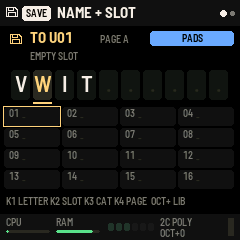
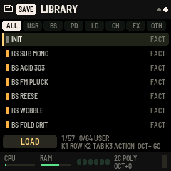
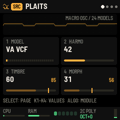
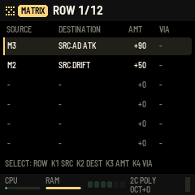
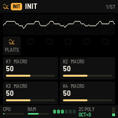
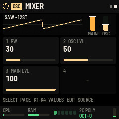
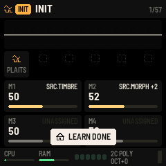
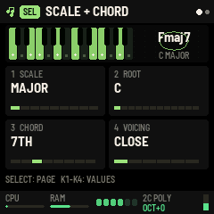
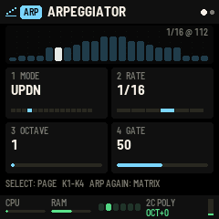
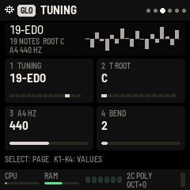

# FM1 Rack (Lite) firmware

The user manual for this firmware: `manual/FM1-Rack-FM1-Firmware-Manual.md` (hosted as `web/manual/fm1.html`).

**Status: builds and passes fm1-base's checks; its sound side passes the computer check; it has not run on an
FM-1.** Don't install it until `fm1/bench` has run on your FM-1 and its FPU check said OK: this firmware plays the
engine in the audio interrupt, and the benchmark is what tells us that's affordable.

## What it does

The FM-1's 67 factory presets (the page's 57, fitted to the FM-1's CPU, and ten of its own), from the Lite modules
(Plaits, Braids, Rings, filter, Tides, Peaks, Grids, FUNC, delay, reverb, chorus), played from the keys (with velocity)
and from USB or TRS MIDI.

Stages 1 to 4 of the menus (sound editing; save and the library; scales, chords, the arpeggiator, tunings and GLOBAL;
the sequencer and the new frame) are in: the page's own pages, buttons and knobs (`menus.c`; the parameters come from the page's definitions through
`make_ui.py` -> `ui_defs.h`).

| Button (printed) | Page |
|---|---|
| HOME | home: the preset, scope, chain, macros. Press again: the RACK overview; again: home (and all notes off) |
| EDIT | the source (Plaits or Braids), then OSC (a second oscillator and the mixer). Hold: UNDO |
| ENV | AMP (envelopes, voice mode; its well shows the envelope on every page), then the shaper (Rings or filter) |
| LFO | MOD A, MOD B, then the three LFOs (and each LFO's two direct targets), then MSEQ, then the 12-row matrix |
| FX | FX 1, then FX 2. Hold, let go, then one tap: FX 1 off / on, two taps: FX 2 (engine set_fx_bypass: skipped, buffers cleared when back on; a preset load turns both on) |
| ARP | the arpeggiator. Two quick taps: arp MODE off, and back to the mode it had |
| SEL | scale + chord, then the keys (QNT, harmony, zone, strum). Two quick taps: CHORD off, and back. Hold: LEARN on / off |
| GLO | GLOBAL: settings, playing, tuning, MIDI, master, system |
| SAVE | the SAVE page: name, slot and category; SAVE again stores it (and it comes back at power-on). OCT+ the library |
| SEQ | the sequencer: NOTES, PATTERN, SPICE, GEN, BANKS, SONG in turn. Hold (0.6 s): the step layer (the 16 white keys are steps) |
| PLAY, REC | start / stop the sequencer; REC READY (stopped) or recording on / off (playing) |

| Knob | Home | A module's page, AMP, LFO | Matrix |
|---|---|---|---|
| PRESET | presets, factory then user (load when you stop turning) | the same | the same |
| ALGORITHM | category | the module picker (press the slot's button to load, HOME to close) | - |
| SELECT | voices, 1-6 | the page within | the row |
| K1-K4 | macros 1-4 (also MIDI CC 20-23) | the page's four parameters | source, destination, amount, via |
| OCT- / OCT+, MASTER | octave, volume | | |

**Save and the library** (`save.c`, after the page's SAVE): 64 user presets, 8 to a store object (A/B sectors,
torn-write safe, in the data area at 0xC8000-0xD7FFF). A user preset keeps the factory preset it started from (for
what the menus don't reach: master EQ, tuning), the six modules and their parameters, AMP, the LFOs, the 18 routes,
the macros and the tempo, a 10-character name and a category: 422 bytes.

| SAVE page | NAME + SLOT | LIBRARY (OCT+ from NAME) |
|---|---|---|
| SELECT | the letter (past the last: the library) | back to NAME (left) |
| ALGORITHM, K1 | change the letter (A-Z 0-9 - # .) | the row (PRESET too) |
| K2 / K3 / K4 | the slot / the category / the page of 16 | the tab (ALL USR BS PD LD CH FX OTH) / the action / - |
| SAVE | store it there (renaming: keep the new name) | back to NAME |
| OCT+ / OCT- | the library / - | do the action (LOAD, COPY, RENAME, DELETE: twice) / back |
| HOME | close | close |

**The wells move** (`vis.c`, after the page's visualisers): Plaits' wave by model (a field of dots for the noise models,
bursts for the drums), Braids' three stepped waves by bit depth and rate, Rings' ripples on each note, the filter's
response curve, Peaks' and Tides' outputs scrolling, Grids' three lanes with the playhead, the delay's repeats, the
reverb's cloud, the chorus' two voices, the LFOs' shapes, AMP's envelope and the voices' levels. The well redraws about
30 times a second, the rest ten. Messages show as the page's toast, a light box over the lower part of the screen.

 

A module's page shows the page's cells: label, value, a bar (ticks for a list), and in the slot's colour the value
modulation has moved it to. The well shows the output (AMP's first page: its envelope). Loading a module stops the
sound for a moment (the arena is laid out again) and says how many voices fit; an edit that needs a bigger buffer (a
longer delay, STR+VERB, SHIMMER) fits it again when the knobs rest ("MEMORY FITTED"). Edits are not kept when the
preset changes unless saved (SAVE). `sim_menus.txt`, `sim_save.txt`, `sim_vis.txt` and `sim_play*.txt` drive the pages in fm1-base's host simulator
(`tools/build.py ../MODFM1/firmware/fm1/rack --host`, then `build/host/fm1rack_host sim_menus.txt OUTDIR`).

 

**After the benchmark (3 Nov 2026):** one FM-1 core played about 2 voices (`../../results/README.md`). The
second core now renders half the voices (the screen shows 2 CORES; 1 CORE* if fm1-base gave it up), and poly
presets start with their own voices (up to 6) on two cores, 4 on one, unless SAVE remembered another number (SELECT asks for up to 6;
the firmware sheds what doesn't fit). A preset that
overloads the core even at one voice (Rings' MODAL measured 102 %) is muted until you pick another, with
**TOO HEAVY FOR FM-1** on the screen, so the screen and controls keep working.

MIDI in (on GLOBAL > MIDI CH, or all): notes (through SEL and the arp, as the keys), pitch bend (± GLOBAL > BEND),
sustain (CC 64), program change (GLOBAL > PROG CHG: factory presets, then user), CC 120/123 (all off), CC 20-23
(macros), clock (GLOBAL > CLOCK MIDI: the arp's steps and the tempo). MIDI out over USB (GLOBAL > MIDI OUT, off by
default as on the page): the notes played (chords and arp included; MIDI in isn't echoed), the clock on the internal
tempo, and with +CC the macros as CC 21-24. The voice modes play as on the page: MONO, LEGATO, and UNI 2 / UNI 4 (each key plays 2 or 4 detuned
voices). If a block of sound takes over 90 % of its time, the firmware drops a voice and shows how many it shed.

The screen takes the page's look (`web/src/2-screen.js`): its colours and 12 x 12 module icons (`icons.h`, converted
from the page's table). A header with the source's icon, the category in a coloured tab and the preset; a well with
the output's scope over the page's dot grid; the chain as icon tiles (orange source, teal shaper, purple modulators,
blue effects; red: asked for but no room in the arena); the macros as cells with rounded bars; a footer with CPU and
RAM bars, a light per voice lit by its envelope, the cores and voice mode (SHED n when voices were dropped, HEAVY when
muted), the octave (green while keys are held) and the output meter.

**OSC and the mixer** (the firmware's own; `engine/rack.cc` osc_mix, the OSC page in `menus.c`): a plain oscillator in
each voice, mixed with the source before the shaper, so the filter or Rings, AMP and the effects take both. WAVE (SINE,
TRI, SAW, SQUARE, PULSE, NOISE; the saw and pulses band-limited with PolyBLEP), OCTAVE (-3..+2), SEMI (±12), FINE (±1
semitone); then the mixer: PW, OSC LVL (0: off, the default) and MAIN LVL (the source, 1 the default). FINE, PW and both
levels are matrix destinations (OSC.). The engine keeps them on AMP's spare parameters 24-30; a preset that leaves OSC
alone sounds exactly as before (every factory preset checked sample for sample against the engine without OSC). SAVE
keeps OSC with the user preset; stage 2's user presets load with it off. The well: two cycles of the wave at its level,
and MAIN and OSC as faders.

**LEARN**: tap EDIT twice quickly (within 0.3 s; a single EDIT tap turns the page once that time has passed). It links the macro last turned on home (on home while learning,
SELECT or K1-K4 pick M1-M4; the macro framed in gold, HOME blinking, a gold band on the pages). On a module, AMP, LFO or
OSC page, turning a parameter's knob links the macro to it in the matrix, in the row it already has or the first free
one of the 12, and the turn sets the amount ("M2>SRC.TIMBRE +24"). Tap HOME, or EDIT twice, to finish. Home's macro cells now show what
each macro moves (its first destination and how many more) or UNASSIGNED.

 

**Stage 3: playing** (`play.c`, `vis3.c`, after the page's 5b-seq.js, 5c-tools.js and 6-engine.js). SEL, GLO and ARP
are settings, not part of a preset: they stay when the preset changes and are saved on their own about 3 seconds
after the last change (the settings record grew: stage 2's preset, octave and voices carry over).

- **SEL**: SCALE (9), ROOT, CHORD (OFF, TRIAD, 7TH, 9TH, 11TH, SUS4, 6TH, POWER: the scale's own chord on each key in
  KEY harmony, a chromatic one in FREE), VOICING (CLOSE, LEAD: the inversion nearest the last chord, OPEN, INV1, INV2,
  +OCT); then QNT (SNAP down to the scale, ALL up to it, WHITE: the scale on the white keys, C4 the root), HARMONY,
  ZONE (with chords on, the seven lowest keys F3-B3 add 6, m7, M7, 9 or force DIM, MIN, MAJ; MIN + MAJ: sus) and
  STRUM (up to 80 ms between notes). The well: two octaves lighting the chord, its name (Cmaj7, Am7/G...), the scale;
  page 2 maps the FM-1's 27 keys to the notes they play. The keys in the scale glow on the keybed; SEL stays half lit
  while chords or QNT are on.
- **ARP**: MODE (UP, DOWN, UPDN, DNUP, RANDOM, ORDER, CHORD, REPEAT, UP+8, CONV, DIVG, PINKY, THUMB, TURING), RATE
  (1/4 to 1/32 with triplets), OCTAVE (1-4), GATE; HOLD (latch), MUTATE and LOOP (the Turing register), SWING. On the
  internal tempo or MIDI clock. The well: the pattern as bars by pitch, the step playing, the register's bits.
- **GLOBAL**: TEMPO, MIDI CH, VOICES (AUTO or 1-6: the same as SELECT on home), CLOCK; VEL CURVE, ANIMATION (the wells:
  full, calm, still), LED BRIGHT (the unlit buttons' glow); TUNING (13: equal, just, Pythagorean, meantone, Werckmeister
  III, Kirnberger III, rast, bayati, slendro, pelog, 19-, 24-, 31-EDO), T ROOT, A4 HZ, BEND; PROG CHG, MIDI OUT, OUT CH,
  LOCAL; LOW / MID / HIGH EQ and COMP (the master, over every preset); SYSTEM (measured: CPU history, arena, voices,
  cores). Each page's well draws it: a metronome, the velocity curve, each degree's cents against equal temperament,
  MIDI traffic, the EQ curve, the CPU graph.
- Home shows small tabs over the scope when SEL, the arp or a tuning is on.

How: the main loop pushes keys through rack_core's queue; the audio interrupt turns them into notes (`play.c`), counts
the notes sounding (two keys may share one), runs the strums and the arp by the codec's frame and applies what falls
due at the start of each block (5.8 ms). Checked in the simulator (`sim_play.txt`, `sim_play2.txt`): C5 plays C-E-G
with TRIAD, C-Eb-G with the zone's MIN key held, a strum spaces C4-E4-G4 by 35 ms, the arp steps, the settings come
back after a reboot. Not yet heard on an FM-1.

  

Flash: 539,548 of 581,632 bytes (about 41 KB free), RAM (.data + .bss) 77,468 of 98,304 bytes, since 8 Nov:
- the engine and the Mutable modules back at -O2 for speed (-Os was 36 KB smaller but about 15 % slower on the FM-1,
  measured 4 Nov); the menus and the platform stay at -Oz. Building rarely played units small inside the -O2 build
  (clang's minsize attribute) was tried and saved nothing measurable, so all units are -O2;
- no USB audio (fm1.toml usb_audio_in / usb_audio_out false: the FM-1 isn't used as a sound card); USB-MIDI stays;
- the splash and panel screens in the bold font (APP_BIG_FONT FONT_B), so the large and medium fonts are left out;
- Rings' chord table const (in flash, 1.4 KB of RAM); the user presets' read buffer shares its RAM with the
  sequencer's undo copy (1.5 KB; reading presets drops the undo).

**Stage 4: the frame, sliders and the sequencer** (after the HTML mockup of 4 Nov; `frame.c`, `seq.c`, `seqpages.c`):

- **The frame**: CPU and RAM sit in a 10-row status strip at the top (voice lights, cores and voice mode, CPU and RAM
  bars with numbers, octave, output meter). The modulation strip first built at the bottom was removed again (5 Nov):
  the sliders show the modulation instead, and the cells are taller.
- **Sliders with a halo** (the dials of the first stage 4 build went back to sliders, 5 Nov): a parameter the matrix
  moves glows in its source's colour: the range it has swept lately round the track, the live value filling it, the
  set value as a tick, a glow round the thumb and the cell's edge that brightens as the modulation moves.
- **Each kind of modulation has its colour**, the same on the sliders and in the matrix: macros gold, velocity green,
  key tracking sky blue, random white, envelopes coral, MOD A / B orange, LFOs violet, MSEQ pink.
- **Home**: a taller scope (84 rows), the chain, the macros as sliders; the sequencer is no longer on home.
- **Pages loop**: SELECT goes round the pages (and the matrix's rows) in both directions.
- **Contrast** (5 Nov): brighter labels, tracks and grid, a darker well, stronger halos, so they stand out on the black.
- **Holds** wait 0.6 s (SEQ's layer), so a quick press is never taken for a hold.
- **The sequencer** (a port of the page's 5d-sequencer.js): 8 banks (A-H) of up to 64 steps, each step up to 6 notes
  with their own length and force, ratchet, nudge, slide, chance; per bank length, division, swing, gate, SPICE and
  DICE; GEN's 18 tools (EUCLID, RANDOM, ACID, ARP, BERLIN ...; ALGO left undoes); BANKS (copy, clear, double, halve;
  switch now or at the loop end); SONG, 16 rows of bank, repeats and transpose. Step entry on NOTES (play a note or chord,
  release, the cursor moves on); REC records into the steps as it plays. It plays in the audio interrupt by the codec's
  frame, on the internal tempo or MIDI clock (MIDI start / stop when CLOCK is MIDI), and sends MIDI out.
- **The sequencer's pages**: its four values as sliders in a row at the top, the piano roll (or the page's picture)
  in the rest, 152 rows tall.
- **MSEQ** (LFO, after the LFOs): four lanes of 16 values on the tempo, the matrix's sources SEQ 1-4, with shapes.
- **SAVE on a sequencer page** keeps the banks and the song (store objects in the data area at 0xB6000-0xC7FFF). The
  sound stops for a moment while the flash is written, so it is never saved automatically while it plays.
- Not yet from the page: parameter locks, the free take, capture, note repeat, FILL.

Checked in the simulator (`sim_seq.txt`): step entry with a chord, playback at the tempo with MIDI out (velocity and
gate as set), MIDI start / stop sent, a modulated slider's halo moving, every sequencer page and the layer drawn; all the other
simulator scripts pass, also under AddressSanitizer. Not yet heard on an FM-1.

**Rings, shared (8 Nov 2026)**: on the FM-1 (engine/rack.cc, RACK_FM1: RINGS_SHARED) one Rings serves every voice,
as on the hardware: each voice adds its source, after AMP's envelope and Rings' EXCITE, to one input, keeps its dry part
(1 - MIX), and each new note strums the next of Rings' RINGS_POLY (2) resonators; Rings' output (times MIX and AMP's
LEVEL) joins the voices before the effects. Its parameters are read with the voice struck last. Memory: one Rings
instead of one per voice, so Rings presets fit 6 voices (they were 1-2). The first core runs Rings and the reverb a
block behind while the second renders voices, so the second takes more of them: the first's work counts as 1.85 voices
for Rings (2.2 with STR+VERB) and 1.4 for the reverb, and each core takes half of what is left (14 Nov 2026). The models MODAL, SYMPATH and SYM QNT (55-58 % of a core for one voice,
bench 4) play as STRING; the menus offer STRING, FM VOICE and STR+VERB (rc_rings_fix maps presets and user presets).

**Factory presets (Nov 2026)**: the page's 57 (`web/presets_src.py`) and, since 14 Nov, the FM-1's own set of 67 built
from them by `presets_fm1.py`: the same names, fitted to the FM-1's CPU (fewer voices where the source is heavy, Rings'
own reverb for the REVERB module, cheaper Plaits models where one sounds the same: see its docstring), FUNC in eight
(PD ANALOG, PD EVOLVING and six of the ten new ones), LFO targets, lead vibratos at 4.5-5.5 Hz (the page's were 1 Hz),
and ten new presets. Their macros start in the middle (the designed sound at 12 o'clock), velocity moves level and
tone, and some basses use OSC as a sub (`"osc"`: make_presets.py adds it as AMP 24-30). The chain, all here:

- `fm1_presets.py` turns them into engine calls (`firmware/tests/presets-fm1-calls.json`) the way the page's preset
  loader does, from the same module definitions (make_ui.load()); `fm1_presets.py --check` shows it gives every page
  preset the calls the page recorded (`tests/presets-calls.json`, record_calls.mjs), so the page isn't needed.
- `level_fm1.py` (needs EURORACK) plays them all through `audition` and sets each LEVEL toward -19 dB on the loud part
  of its phrase (`presets_fm1_levels.json`). MODAL percussion (CH MARIMBA, CH MUSIC BOX, FX CHIMES, FX GLASS RAIN)
  stays 5-8 dB under at full LEVEL: its peaks reach the limiter first.
- `make_presets.py` (and `--full`) writes presets.h; the bench's `make_cases.py` its cases from the same file.

To change a preset: edit presets_fm1.py (or presets_src.py for both), then `python3 fm1_presets.py && python3
level_fm1.py && python3 make_presets.py && python3 make_presets.py --full`, and the bench's make_cases.py (and --full).

`build/host/audition OUTDIR` (built by build_host.sh) plays every preset through the firmware's sound path (rc_load,
rc_render at 44.1 kHz) with a phrase for its category and writes a WAV each, with its peak and loudness.

## How it works

- `rack_core.c`: presets (INIT, then the preset's differences, then each module's parameter ranges, packed in
  `presets.h` by `make_presets.py`: 22 KB), a note queue from the main loop to the audio interrupt, the voice modes,
  the overload shedding, and the resampler: the engine renders 48 kHz, the codec plays 44.1 kHz, so the output is
  resampled (linear) each block. Loading a preset makes the audio interrupt play silence while the main loop loads.
- `app.c`: the screen and controls, on fm1-base (the template's patterns).
- `../common/rk.cc`, `../common/rt.cc`: the engine's C names, and the C++ runtime and maths fm1-base lacks (as in
  `fm1/bench`).

## Checked

`sh build_host.sh && build/host/rack_host` (needs `EURORACK`): every preset loaded as the firmware loads it sounds
the same as the preset's own calls, sample for sample; the resampler keeps the pitch and has no step at block
edges; every preset makes sound through the firmware's audio path; the unison modes play 2 and 4 notes per key.

fm1-base's build (with placeholder SDK files here, so its package was deleted): image 544 KB of the 568 KB app area,
no soft-double routines, pool within its headroom.

## Memory: the big buffers sized to the preset

The arena is 308 KB (what fm1-base's pool leaves). After a preset loads, `rk_fm1_fit` (rack.cc `fm1_fit`) sizes the
big buffers to what the preset can use and lays the arena out again, so the room left goes to voices:

- **the delay line** to the preset's delay time (plus TAPE's wow), not 1 s; the full second when a matrix row can
  move its time;
- **the reverb's pre-delay lines** to the preset's pre-delay (a power of two), not 170 ms; **the shimmer line** only
  when SHIMMER is reachable;
- **Rings' own reverb** (64 KB a voice) only when STR+VERB is reachable (the shim's `rings/dsp/fx/fx_engine.h`
  leaves a null buffer alone; render_voice keeps the model off STR+VERB then).

These four change nothing in the sound: with the same voices, every preset comes out sample for sample as before
(one, CH DUSTY KEYS, differs by 1e-5 at most: TAPE's wow reads a shorter line at a float position).

- **Rings' strings in 16-bit** (`-DRACK_RINGS16`, the shim's `rings/dsp/string.h`): 8 strings of float delay lines
  were 99.6 KB a voice, now 49.8 KB. This one changes the sound slightly: on the computer, against the float strings,
  the difference is 55-76 dB below the signal for the Rings presets, and their decays end at the same level (no
  hanging tails). Full scale is +/-4 (the strings peaked at 2.05).

Voices the arena now fits (computer check; the CPU may still shed some on the FM-1): LD RESO STRING and PD SYMPATH 1 to 3; KARPLUS gets its Rings
back (2 voices; before, its delay left no room and Rings was unloaded); PD SHIMMER 1 to 5; PD GLASS AIR and BS DUB
ROUND 1 to 4; PD DARK DRONE and FX TIDAL DRONE 1 to 3 (their delay is a full second); LD SAW SOLO, LD SYNC SCRM, LD CHIP
SQ, LD PWM SOLO, LD SQUARE CHIP, PD EVOLVING WT, CH PLUCK HARP, CH HOUSE STAB, CH STRING PLK, FX RISER, FX LASER ZAP, FX SAMPLEHOLD, FX NOISE SWEEP,
FX METAL RING, GRID GATE and TIDAL FM to 6.

The page's FM-1 preview (GLOBAL > HARDWARE) still uses the full sizes, so it now predicts fewer voices than the
firmware plays.

## Build and install

As `fm1/bench` (its README), with this folder: `tools/build.py ../MODFM1/firmware/fm1/rack`, then
`python3 tools/fm1_install.py ../MODFM1/firmware/fm1/rack/build/fm1rack.fwsc`. Identity `FM-1_7800`
(`id_prefix` picked for this project, not registered anywhere).
