# FM1 Rack on the FM-1: Firmware Manual

Nov 11, 2026 · Josh Cowley

FM1 Rack turns the M-VAVE FM-1 into a small modular synthesizer built from Mutable Instruments' open module code. Each sound is a short chain of modules: a source (Plaits or Braids), a shaper (Rings or a filter), two modulators, two effects and an amplifier. You play it from the keys, shape it with the knobs, and link anything to anything through a modulation matrix. This manual covers the firmware on the FM-1; the browser version has its own manual, the [FM1 Rack Manual](index.html).

> **This is a test version (update 43).** The sound engine and the first menus have been played on an FM-1. The newer screens, the FUNC module, the 67 factory presets, the button shortcuts, STYLE, the smoother preset and knob changes, LEARN on SEL + EDIT, the chords' and arpeggio's FM-1 / SEND switches, the finer pictures, the BASS zone and the sequencer's editing (lasso, copy and paste, dynamics, articulations) and the click track have so far run only in a computer simulator of the FM-1. Keep the recovery steps in section 2 to hand.

## Contents

1. Quick start
2. Installing, and getting back to stock
3. The panel
4. Reading the screen
5. HOME
6. How a sound is built
7. AMP and OSC
8. Modulation
9. FUNC: functions and a mixer
10. Playing: SEL, ARP, shortcuts, GLOBAL and MIDI
11. The sequencer
12. Saving and the library
13. Voices and the processor
14. Factory presets
15. Troubleshooting
16. What isn't in yet

## 1. Quick start

1. **Install** with the script in section 2. The FM-1 starts on HOME with the first preset, INIT.
2. **Choose a sound**: turn **PRESET**. The new preset loads when you stop turning. **ALGORITHM** jumps a whole category (keys, bass, lead, pads, textures).
3. **Play** the keys. They respond to how hard you play.
4. **Shape it**: on HOME, **K1–K4** are the preset's four macros. Each starts in the middle, where the preset sounds as designed, and moves something useful (brightness, character, space, motion). The name under each says what it moves.
5. **Look inside**: press **EDIT** for the sound source, **ENV** for the envelopes and the shaper, **LFO** for the modulation, **FX** for the effects. On each page, **K1–K4** set the four parameters shown and **SELECT** turns the page.
6. **Undo**: hold **EDIT** to put back the last change.
7. **Keep it**: press **SAVE**, then SAVE again. Section 12 covers names and slots.
8. **Back home**: press **HOME**.

## 2. Installing, and getting back to stock

### Before you install

- **Do the recovery round trip once**, so you know you can get back to the stock firmware:
    1. Plug the FM-1 **straight into the Mac**, with no hub.
    2. In Chrome or Edge, open Felucca's web installer (hugelton.github.io/Felucca) and install Felucca.
    3. Play it, then choose **Return to official V15**.
- **Run the benchmark once** (`install_bench.sh`): its top line must read **FPU OK: HARDWARE FLOAT, EXACT**. FM1 Rack needs the FM-1's hardware floating point.
- Quit anything else that uses MIDI: DAWs, and browser tabs with Web MIDI.

### Installing

Everything is in the **FM1-Rack** folder (`Documents/iClaude/Projects/FM1-Rack`). In Terminal:

```
sh /Users/josh/Documents/iClaude/Projects/FM1-Rack/install_rack.sh
```

The script:

1. checks that `test-kit/packages/fm1rack.fwsc` is exactly the file that was built (its SHA-256 fingerprint);
2. installs the installer's MIDI library if needed;
3. fetches fm1-base's installer at a fixed version;
4. finds the FM-1 and installs.

Don't unplug the FM-1 until it says it's done. The firmware identifies itself as **FM-1_7800**.

By hand, from the repo's `firmware/packages` folder:

```
shasum -a 256 -c SHA256SUMS
python3 ~/fm1-base/tools/fm1_install.py fm1rack.fwsc
```

### Getting back to the stock firmware

In order of what to try:

1. Felucca's web installer again, then **Return to official V15**.
2. fm1-base's installer page: "Back to the stock firmware".
3. After two failed starts the FM-1 comes up in **safe mode** (no audio, USB on), which accepts an update.
4. After four, the chip's own update mode: M-VAVE's **M-UPGRADE** (Downloads › PC Software) restores the stock firmware.

These steps come from fm1-base and Felucca. None has been needed with FM1 Rack so far.

## 3. The panel

### Buttons

Each page button opens its first page; tap it again for its next page, and after the last it comes back to the first. A button counts as held only after 0.6 s, so a quick press is never taken for a hold.

| Button | Tap | Tap again | Hold, or two or three quick taps |
| --- | --- | --- | --- |
| **HOME** | HOME | RACK, an overview of every slot; once more, HOME with all notes off | Also closes the module picker, the SAVE page and LEARN |
| **EDIT** | the source (Plaits or Braids) | OSC, the second oscillator and mixer | **Hold: UNDO** the last change; hold again to go further back (up to 16). With SEL: LEARN. On the sequencer's NOTES: **delete** (section 11) |
| **ENV** | AMP (envelopes, voice mode) | the shaper (Rings or the filter) | |
| **LFO** | MOD A | MOD B, the LFOs, MSEQ, the MATRIX | **Two taps: the MATRIX** |
| **FX** | FX 1 | FX 2 | **Hold, let go, then one tap: FX 1 off or on; two taps: FX 2** (section 10) |
| **ARP** | the arpeggiator | HOLD + TURING | **Two taps: the arpeggio on the FM-1 off or on. Three taps: its send off or on** (section 10) |
| **SEL** | scale and chord | (SELECT turns its pages: KEYS + STRUM, then the MIDI controller pages STYLE, LAYER MIDI CH, CHORD + ARP, then FEEL) | **Two taps: chords off (the keys play single notes) or back on. Three taps: the chords' send off or on** (section 10). **Hold SEL and EDIT together (half a second): LEARN on or off** (section 8) |
| **GLO** | GLOBAL settings | | |
| **SAVE** | the SAVE page | SAVE again stores the preset | On a sequencer page: stores the sequencer |
| **SEQ** | the sequencer, at the page you last used | the next sequencer page | **Hold: the step layer** (section 11) |
| **PLAY** | start or stop the sequencer | | |
| **REC** | stopped: REC READY (then PLAY: a bar's count-in, then recording); playing: recording on or off | | |
| **OCT− / OCT+** | octave down or up | | On SAVE: OCT+ opens the library. In the step layer: the previous or next 16 steps |

SEL held on its own does nothing, so LEARN can't start by accident; held together with EDIT it never counts as UNDO or a page turn.

Buttons with a hold act when you let go; a single tap of SEL, ARP or LFO opens its page straight away, and a second or third quick tap (within 0.3 s) then does the double or triple tap's job and takes you back to the page you were on. (Update 38 fixed a fault that made about every other tap of EDIT, SEL, ARP, SEQ, HOME or FX count as a hold and do nothing.)

**The lights** show where you are. The page's button is lit and the others glow (GLOBAL › LED BRIGHT sets how much). SEL glows half while chords or QNT are on, and ARP while the arpeggiator is on. PLAY is lit while the sequencer runs; REC is lit while recording and blinks during REC READY. HOME blinks while LEARN is on.

### Knobs

| Knob | HOME | A sound page (module, AMP, LFO, OSC) | MATRIX | Sequencer pages |
| --- | --- | --- | --- | --- |
| **PRESET** | presets: factory, then yours; the preset loads when you stop turning | the same | the same | the same |
| **ALGORITHM** | jump a category | the module picker | ROUTES or TARGETS | the page's action |
| **SELECT** | voices, 1–6 | the page within | the row | the step, bank or row |
| **K1–K4** | macros M1–M4 | the page's four parameters | source, destination, amount, via | the page's four values |
| **MASTER** | volume | | | |

SELECT always goes round: past the last page or row it comes back to the first, both ways.

### Keys

The 27 keys play notes with velocity. While the step layer is open, the 16 white keys are sequencer steps instead.

## 4. Reading the screen


Every page has the same frame, top to bottom.

- **The status strip**:
    - a light for each voice, lit by its envelope;
    - the cores and voice mode: **2C POLY** on two cores, **1C** on one, **1C\*** if the second core didn't start;
    - **SHED n** in gold when n voices were dropped to save processor time, **HEAVY** in red when a preset is muted (section 13);
    - **CPU**, a bar and a number: gold above 70 %, red above 85 %;
    - **RAM**: how much of the sound memory the preset uses;
    - the octave (**O+1** and so on; green while keys are held);
    - the output meter (red near clipping).
- **The header**: the page's tag in its colour, the page's name, and a dot for each page within it.
- **The picture**: a moving picture of what the page does to the sound: the source's wave, the filter's curve, the envelope, the LFO shapes, Rings' ripples, the delay's repeats. It fills the top half of every page that has one. GLOBAL › ANIMATION sets it to full, calm or still.
- **The gauges**: one per knob along the bottom, each an arc with its value.
- **The help line**: what the controls do on this page.
- **Messages** appear for a moment in a light box near the bottom ("SAVED TO U01", "PLAITS 6 V", "CHORDS OFF").

### Knob colours

Each knob keeps its colour on every page: **K1 blue, K2 green, K3 white, K4 orange**. The part of the picture a knob moves is drawn in that colour, so turning the green knob moves the green part. For example:

- **AMP**: attack, decay, sustain and release are four coloured segments of the envelope.
- **The filter**: a dashed line at the cutoff and a dot on the resonance peak.
- **Plaits and Braids**: the wave in TIMBRE's colour.
- **Rings**: the guide rings in STRUCTURE's colour, the ripples in BRIGHTNESS's.
- **Delay, reverb, chorus**: the repeats in FEEDBACK's colour, the reverb's cloud in SIZE's, the chorus' two lines in RATE's and DEPTH's.

On HOME the macros take the same colours: M1 blue, M2 green, M3 white, M4 orange.

### Modulation on the gauges

A parameter that something is moving shows it, in the colour of what moves it:

- an outer arc round the gauge shows the range it has swept lately, brighter the faster it moves;
- a dot on that arc is where it is now, and the small number under the gauge (› 62) is its live value;
- the inner arc and its white thumb stay where you set it.

On the slider pages the same shows as a halo round the track.


Each kind of source has its colour everywhere:

| Source | Colour |
| --- | --- |
| Macros M1–M4 | gold |
| Velocity | green |
| Key tracking | sky blue |
| Random | white |
| AMP ENV and MOD ENV | coral |
| MOD A and MOD B outputs | orange |
| LFO 1–3 | violet |
| SEQ 1–4 (MSEQ lanes) | pink |

## 5. HOME

HOME shows the preset's category, name and number (or its user slot), the sound's path, the four macros and the output.

- **The path**: the slots in use, as live tiles in the order the sound goes through them: SRC › SHP › FX 1, then down to FX 2. Dots run along the arrows, as bright as the output. Empty slots are left out and the path closes up.
- **The tiles**: each slot's module, moving with what it is doing to the sound right now. The colours tell the kinds apart: orange sources, teal shapers, purple modulators, blue effects.
    - A switched-off effect shows **OFF** (section 10).
    - A red tile is a module the preset needs that didn't fit in memory.
- **The modulators** loaded in MOD A and MOD B sit under the path; small arrows pulse up from them as their outputs move.
- **The macros**: each with its value (0–100), an arc in its knob's colour, and what it moves (the first destination, "+2" if more), or **UNSET**. K1–K4 turn them; so do MIDI CC 20–23.
- **The tabs** along the bottom show what's on besides the preset: the scale and chord, the arpeggiator, the STYLE, a tuning. A red tab on the left, **KEYS: FM-1 OFF** (or **ARP: FM-1 OFF**), means the keys or the arpeggio aren't playing the FM-1's sound (SEL › CHORD + ARP › CHD FM-1, or two quick taps on ARP; section 10). (Update 39 took away the waveform that ran along the bottom, and HOME now only redraws the macros and tabs when they change, so it takes less of the processor's time.)

**PRESET** chooses the preset, **ALGORITHM** jumps a category and **SELECT** sets the voices (1–6). Changing preset, or loading a module into a slot, fades the sound out over a few milliseconds and the new one in, so it doesn't click; nothing of the old sound (its echoes, its last few samples) carries into the new one. Knobs glide to their new values over a few milliseconds too, so a level, a cutoff or a chorus turned quickly doesn't click or zipper; a choice from a list (a model, a type) still changes at once. Tap HOME again for **RACK**, a list of every slot, AMP, the outputs and how many matrix routes are set.

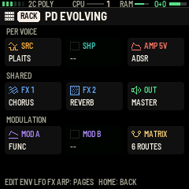

## 6. How a sound is built

### The chain

| Slot | Choices | Button |
| --- | --- | --- |
| **SRC** (source) | Plaits, Braids | EDIT |
| **SHP** (shaper) | Rings, the filter, or empty | ENV twice |
| **MOD A**, **MOD B** (modulators) | Peaks, Tides, Grids, FUNC, or empty | LFO |
| **FX 1**, **FX 2** | delay, reverb, chorus, or empty (not the same one twice) | FX |
| **AMP** | the envelopes and voice mode (always there) | ENV |

Every voice has its own source, shaper and amplifier. The modulators and effects are shared by all the voices, and so is Rings (see below).

### The modules

| Module | What it does | Its main parameters |
| --- | --- | --- |
| **Plaits** | A macro oscillator with 24 models: virtual analog, phase distortion, FM, wavetables, chords, speech, swarm, noise, particles, modal and string physics, drums | MODEL, HARMO, TIMBRE, MORPH; LPG and DECAY (its own low-pass gate); ENV>TIMB, ENV>MRPH, ENV>FM; AUX MIX |
| **Braids** | A macro oscillator with 47 shapes: saws, triple and swarm oscillators, sync, vowels, plucked, bowed and blown models, bit-crushed and noisy shapes | MODEL, TIMBRE, COLOR, DRIFT; BITS and RATE (crushing); its own AD envelope onto TIMBRE, COLOR, pitch or level |
| **Rings** | A resonator that the voices ring; on the FM-1 the models STRING, FM VOICE and STR+VERB | STRUCT, BRIGHT, DAMPING, POSITION, EXCITE, MIX (dry and rung), SPREAD, TUNE, CHORD |
| **Filter** | A state-variable filter per voice: LP, BP, HP, LP24, NOTCH, PEAK | CUTOFF, RESO, DRIVE; ENV AMT from AMP's envelope, its own (F ATK–F REL) or MOD ENV; KEY TRK; SAT; GAIN |
| **Peaks** | An envelope, LFO or tap-tempo LFO | FUNC, K1, K2, GATE, SUSTAIN, INVERT |
| **Tides** | A slope generator: AD, LOOP (an LFO) or AR | FREQ, SHAPE, SLOPE, SMOOTH, RANGE, GATE |
| **Grids** | A drum-pattern map giving triggers and accents | X, Y, FILL, OUT, CHAOS, DECAY |
| **FUNC** | Two slopes, two scaled inputs and a mixer, after Maths (section 9) | RISE, FALL, CURVE, CYCLE, TRIG, levels, outputs |
| **Delay** | Stereo echo: ping-pong, mono or tape | TIME (in beats or free), FEEDBACK, TONE, MIX, WOW, LO CUT, DUCK |
| **Reverb** | Plate, hall or shimmer | SIZE, DAMP, DIFFUSE, MIX, PRE, SHIMMER, LO CUT, DUCK |
| **Chorus** | Chorus, flanger or vibrato | RATE, DEPTH, WIDTH, MIX, FEEDBACK |

### Module pages

Open a slot with its button. **SELECT** turns the pages within the module; **K1–K4** set the four parameters shown.

**Changing a module**: on its page, turn **ALGORITHM**. The picker opens on the module now loaded. Turn to choose, then press the slot's button again to load it, or HOME to leave it as it was. Loading stops the sound for a moment while memory is laid out again. It then says how many voices fit ("BRAIDS 6 V"), or "NO ROOM".


**Memory**: some edits need more memory (a longer delay, Rings' STR+VERB, the shimmer reverb). When you stop turning, FM1 Rack lays the memory out again, with a moment's silence, and says **MEMORY FITTED** with the voices.

**The MOD page**: after a module's last page (and AMP's and OSC's) comes its **MOD** page. It lists the matrix routes into that module, four at a time, under the module's picture. SELECT steps down the rows. On the selected row, **K1** sets the source, **K2** the target (only this module's parameters, so the list is short), **K3** the amount and **K4** the via (section 8). On a free row, turning a knob adds a route.

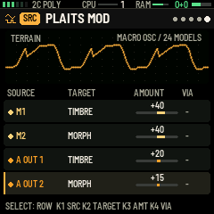

**UNDO**: hold EDIT to put the last change back: a parameter, a matrix route, or a SEL, ARP or GLOBAL setting ("UNDO SRC.COLOR"). Hold it again to go further back, up to 16 changes. One turn of a knob counts as one change. Changing preset or loading a module starts afresh.

Edits are lost when you change preset unless you SAVE.

### Rings on the FM-1

There is **one Rings shared by all the voices**, as on the hardware module. Every voice's sound excites it, and it rings up to two notes at once: each new note takes the next resonator, so a third note cuts off the oldest ring. The dry part of each voice (set by Rings' MIX) plays as well. Rings' parameters follow the last note played.

- **Models**: STRING, FM VOICE and STR+VERB. MODAL, SYMPATH and SYM QNT are too heavy for the FM-1, so a preset asking for one plays STRING. For struck and bell sounds, Plaits' own MODAL and STRING models are the light alternatives.
- **STR+VERB** adds Rings' own reverb to the strings. DAMPING then sets the strings' decay and the reverb's size together. It is much lighter on the processor than a separate reverb module.
- **Sample rate**: to fit the processor, Rings runs at half the sample rate (24 kHz). Its tuning, decays and tone are kept, but it has nothing above 12 kHz.

## 7. AMP and OSC

### AMP

ENV opens AMP, which has six pages:

1. ATTACK, DECAY, SUSTAIN, RELEASE
2. VEL AMT, GLIDE, SPREAD (stereo), LEVEL
3. M ATTACK, M DECAY, M LOOP: the mod envelope (the matrix source MOD ENV)
4. MODE (POLY, MONO, LEGATO, UNI 2, UNI 4), DETUNE, VINTAGE
5. DELAY, HOLD, A CURVE, D CURVE
6. VEL>ATK, KEY>TIME, M SUST, PITCH ENV

UNI 2 and UNI 4 play two or four detuned voices per key. The envelope is drawn on every page.


### OSC: the second oscillator

Tap EDIT twice for OSC: a plain oscillator in every voice, mixed with the source **before** the shaper, so the filter or Rings, AMP and the effects take both.

- Page 1: **WAVE** (SINE, TRI, SAW, SQUARE, PULSE, NOISE), **OCTAVE** (−3 to +2), **SEMI** (±12), **FINE** (±1 semitone).
- Page 2, the mixer: **PW** (pulse width), **OSC LVL** (0, off, by default), **MAIN LVL** (the source's level, 100 by default), **AUX LVL** (Plaits' second output, on its own level; Plaits only).

With OSC LVL at 0 a preset sounds as it would without OSC. Several factory basses use OSC as a sub-oscillator an octave down.

 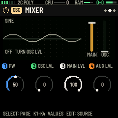

## 8. Modulation

Anything in a preset can move anything else. The movers (sources) are:

- the macros **M1–M4**;
- **VELO** (how hard a key was played), **KEY TRK** (which key), **RANDOM** (a new value each note);
- the envelopes **AMP ENV** and **MOD ENV**;
- the modulators' outputs **A OUT 1, A OUT 2, B OUT 1, B OUT 2**;
- the LFOs **LFO 1–3**;
- the MSEQ lanes **SEQ 1–4**.

They reach their destinations three ways: the LFOs' own targets, the matrix (and each module's MOD page, which shows part of it), and LEARN.

LFO steps through **MOD A, MOD B, LFO, MSEQ** and the **MATRIX**. Tap it twice quickly to go straight to the MATRIX.

### LFOs

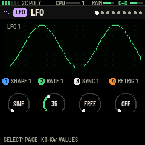

The LFO page has nine pages (SELECT):

- pages 1–3: SHAPE (SINE, TRI, SAW, SQUARE, S&H, DRIFT), RATE, SYNC (FREE, or 1/16 to 2 BARS of the tempo), RETRIG, for LFO 1, 2 and 3;
- pages 4–6: FADE (a fade-in from each note), PHASE, POLAR, 1SHOT, for each;
- pages 7–9: **LFO TARGET**, each LFO's two direct destinations. K1 and K3 choose the destination, K2 and K4 the amount.

RATE runs from about 0.03 Hz to 30 Hz; at 75 it is about 5 Hz, a singer's vibrato.


### The matrix

The MATRIX holds 12 routes. **SELECT** chooses the row. **K1** sets the source, **K2** the destination, **K3** the amount (−100 to +100). **K4** sets a **via**: a second source that scales the route. With VELO as the via, for example, harder notes modulate more.

Destinations are any parameter that can be modulated on SRC, SHP, MOD A, MOD B, FX 1, FX 2, AMP and OSC, plus pitch and pan.


**By target**: turn **ALGORITHM** to switch between **ROUTES** (the 12 rows) and **TARGETS**, the same routes sorted by what they move, so "what moves the cutoff?" reads off one place. SELECT moves along the list, and K1–K4 edit a route as on ROUTES.

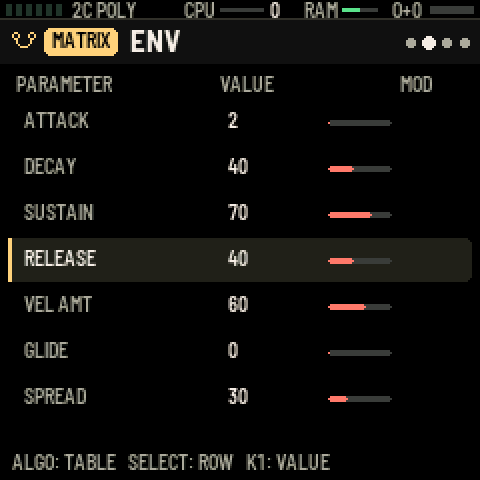

### Macros

M1–M4 are matrix sources you play with K1–K4 on HOME. Every factory preset sets them up so that at 50 the preset sounds as designed, and turning a macro moves its parameter either side.

### LEARN: linking by turning a knob

1. On HOME, turn the macro you want to link.
2. **Hold SEL and EDIT together** for half a second. LEARN is on: the macro is framed in gold on HOME, HOME blinks, and a gold band replaces the help line on every page.
3. Go to any module, AMP, LFO or OSC page and **turn the knob of the parameter** you want it to move. The link is made in the matrix, and how far you turned sets the amount: **M2>SRC.TIMBRE +24**.
4. Turn more parameters to link more, then **hold SEL and EDIT again** to finish (tapping HOME also ends it).


**Any source**: while LEARN is on, **turn ALGORITHM** to choose what you're linking: a macro, velocity, key tracking, random, an envelope, a modulator's output, an LFO or an MSEQ lane. The gold band shows it. Then turn a parameter's knob as before. For example: hold SEL and EDIT, turn ALGORITHM to LFO 1, open the filter and turn CUTOFF: **LFO 1>SHP.CUTOFF +20**.

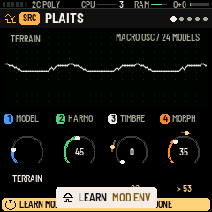

### MSEQ: the modulation sequencer

MSEQ (on LFO, after the LFOs) has four lanes of 16 values that step with the tempo: the sources **SEQ 1–4**. **SELECT** chooses the step, **ALGORITHM** the lane, **K1** the value (−100 to +100), **K2** a shape to draw across the lane (RAMP+, RAMP−, TRI, SINE, SQR, RND, FLAT, INVERT, SHIFT), **K3** the RATE (1/32 to 2 BARS), **K4** SMOOTH.


## 9. FUNC: functions and a mixer

FUNC is a modulator for MOD A or MOD B, after Make Noise's Maths. To load it, open MOD A or B with LFO, turn ALGORITHM to FUNC, and press LFO. It has two function generators (channels 1 and 4), two inputs (channels 2 and 3) and a mixer, and gives two outputs to the matrix (**A OUT 1** and **A OUT 2** in MOD A).

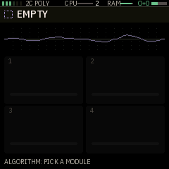

| Page | K1 | K2 | K3 | K4 |
|---|---|---|---|---|
| CH 1 | RISE 1 | FALL 1 | CURVE 1 | CYCLE 1 |
| CH 4 | RISE 4 | FALL 4 | CURVE 4 | CYCLE 4 |
| TRIG | TRIG 1 | TRIG 4 | TRIG SRC | HOLD |
| IN | CH 2 SRC | CH 2 AMT | CH 3 SRC | CH 3 AMT |
| MIX | LVL 1 | LVL 2 | LVL 3 | LVL 4 |
| OUT | OUT 1 | OUT 2 | | |

- **Channels 1 and 4** rise and fall once for each trigger; each slope takes 1 ms to 20 s. **CURVE** bends them: one way the slope moves fast then slowly, the other way slowly then fast. **CYCLE ON** repeats a channel: an LFO whose shape is its rise and fall.
- **TRIG** chooses what starts a channel:
    - **NOTE**: each key;
    - **GATE**: keys held;
    - **1/16, 1/8, 1/4, BAR**: the tempo;
    - **OTHER EOC**: the other channel finishing, to chain them;
    - **SOURCE**: the source in TRIG SRC going over the middle, such as an LFO, an MSEQ lane or FUNC's own outputs;
    - **OFF**.
  A trigger during a slope starts the rise again from where it is.
- **HOLD**: **AD** falls straight after the rise. **AR** stays at the top while the trigger is held, which makes an attack-release envelope with GATE or SOURCE. HOLD applies to both channels.
- **Channels 2 and 3** take any matrix source and scale it by their AMT (−100 to +100). With no source, AMT is a fixed offset.
- **MIX**: each channel's level into the SUM (−100 to +100).
- **OUT 1 and OUT 2** each pick one of:
    - **CH 1** or **CH 4**;
    - **SUM**, or **INV** (the SUM upside down);
    - **OR**: the highest of the four;
    - **EOR**: on while channel 1 falls;
    - **EOC**: a short pulse when channel 4 finishes.
- Every RISE, FALL, CURVE and LVL can be modulated, by FUNC's own outputs too.

The picture draws both channels' shapes, with OUT 1 and OUT 2 scrolling underneath.

**Some patches to start from** (each is in a factory preset):

- **A filter that blooms while you hold a chord** (PD SLOW BLOOM): CH 1 on GATE with HOLD AR, a slow rise; route A OUT 1 to the cutoff.
- **A rhythmic gate** (PD TEMPO GATE): CH 1 on 1/8 with a quick rise and a short fall; route it to the cutoff and a little to AMP's LEVEL.
- **Two movements against each other** (PD EVOLVING): CH 1 and CH 4 cycling at unrelated rates; CH 2 with no source and AMT −50 as an offset; OUT 1 the SUM to one parameter, OUT 2 the INV to another.
- **Ping-pong** (FX BOUNCE): CH 1 cycling; OUT 1 its EOR; CH 4 triggered by SOURCE with TRIG SRC set to A OUT 1, so it rises as CH 1 falls. LVL 1 −100 and LVL 4 +100 make OUT 2 (SUM) swing both ways: route it to PAN.
- **A wobble mixed with a pluck** (BS WOBBLE): CH 1 on NOTE, CH 4 on 1/8, both into the SUM; the wobble's level (LVL 4) on a macro.

## 10. Playing: SEL, ARP, shortcuts, GLOBAL and MIDI

SEL, ARP and GLOBAL are settings of the instrument, not of a preset. They stay when you change preset and are saved by themselves about 3 seconds after your last change.

### SEL: scales, chords and the keys


**Page 1, SCALE + CHORD**:

- **SCALE** (9 scales) and **ROOT**.
- **CHORD**: OFF, TRIAD, 7TH, 9TH, 11TH, SUS4, 6TH, POWER. With a chord on, every key plays the scale's chord on that note, and the picture shows the chord and its name.
- **VOICING**: CLOSE, LEAD, OPEN, INV1, INV2, +OCT.

**Page 2, KEYS + STRUM**:

- **QNT**: snap notes to the scale; WHITE puts the scale on the white keys.
- **HARMONY**.
- **ZONE**: what the seven lowest keys (F3–B3) do:
    - **CHORDS** (to start with): with chords on, they colour the chord: add 6, m7, M7 or 9, or force DIM, MIN or MAJ. MIN and MAJ together give sus.
    - **OFF**: they play notes like the others.
    - **BASS** (with a STYLE on): they pick the chord tone the STYLE's bass line plays, from left to right **root, 3rd, 5th, 7th, octave up, 5th below, approach note** (a semitone under the root). The style still gives the rhythm and accents; the key held last wins; with none held the style plays its own bass line. With HELD, the held bass moves to the new tone at once. Switching ZONE back to CHORDS returns the bass to the style's own line.

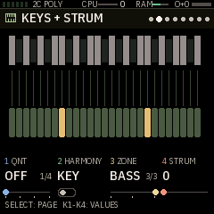
- **STRUM**: up to 80 ms between the chord's notes, lowest first. It also strums the chords the sequencer plays back (it's applied as they play, so turning it changes recorded chords too).

**Page 6, FEEL**: **HUMAN** (0–100, 0 to start with): each note of a chord comes a little late at random (up to 35 ms at 100) and a little softer or louder, so chords sound played rather than machine-tight. It works on the keys and on the chords the sequencer plays, together with STRUM, and is different every time.

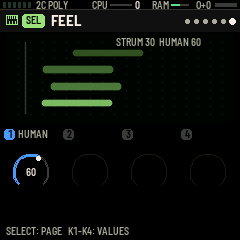

The keys in the scale glow on the keybed.

### ARP: the arpeggiator


- **Page 1**: MODE (OFF, UP, DOWN, UPDN, DNUP, RANDOM, ORDER, CHORD, REPEAT, UP+8, CONV, DIVG, PINKY, THUMB, TURING), RATE (1/4 to 1/32, with triplets), OCTAVE (1–4), GATE.
- **Page 2**: HOLD (latch), MUTATE and LOOP (for TURING, a looping random pattern), SWING.

It follows the tempo (GLOBAL › TEMPO) or MIDI clock, and the picture shows the pattern and the step playing.

**HOLD as a chord latch**: with HOLD on and MODE OFF, notes and chords keep sounding after you let go. Playing again once every key is up replaces them; keys added while others are held add to them. Turning HOLD off, changing MODE, or stopping the sequencer with PLAY ends them.

### Chords and arpeggio: on the FM-1, and sent

What you play on the keys (a chord, or a single note with chords off) and what the arpeggiator plays each have two stages, switched separately:

- **ON FM-1**: you hear it on the FM-1's own sound;
- **SEND**: it goes out over MIDI on its own channel, SEL › LAYER MIDI CH › **CHORD CH** (1 to start with) or **ARP CH** (3), so another synth can play it.

All four are on to start with. Switch them on SEL's last page, **CHORD + ARP**, or with quick taps:

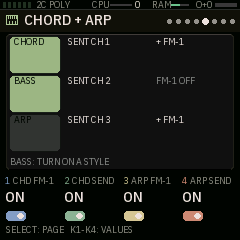

| | On the FM-1 | Sent |
| --- | --- | --- |
| Chords (SEL) | on the page only | **three taps on SEL** |
| Arpeggio (ARP) | **two taps on ARP** | **three taps on ARP** |
| On the page | CHD FM-1 | CHD SEND |
| | ARP FM-1 | ARP SEND |

Each tap gesture shows what it did, for example **CHORDS: SEND OFF** or **ARP: ON FM-1 OFF**, and while one is off HOME shows a red **KEYS: FM-1 OFF** or **ARP: FM-1 OFF** tab, so a silent FM-1 is never a mystery.

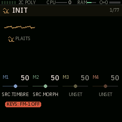
 Notes already sounding stop at once when you switch their stage off. With ON FM-1 off and SEND on, the FM-1 is silent and the other synth plays; with both off, nothing plays. SEND needs GLOBAL › MIDI OUT on (the message says so if it's off). The arpeggio's switches only matter while the arpeggiator is running (ARP › MODE).

These work with or without a STYLE. Two quick taps on SEL don't silence the keys: they turn the chords off, so the keys play single notes (two taps again bring the chord type back). To turn the arpeggiator off, use ARP › MODE.

### STYLE: chords, bass and arpeggio on three channels

SEL's pages 3–5 (the MIDI controller pages; they were on ARP before update 38) turn the FM-1 into an accompaniment for itself and for other synths. While you hold a chord, it goes out in three layers:

- **CHORD**: the chord, as you play it: it starts when you press the keys (strummed, if SEL › STRUM is set) and holds for as long as you hold them;
- **BASS**: a bass line built from the chord's root (root, fifth, third, seventh, octave, passing and approach notes), **in the style's rhythm**. The style shapes the bass only;
- **ARP**: the arpeggiator as it runs, when its MODE (page 1) is on.

Each layer goes out on its own MIDI channel, and you choose which ones the FM-1 plays itself (the chords and the arpeggio as in the section above). With a layer's FM-1 switch off, you don't hear it on the FM-1: it goes only to the other synth. So the FM-1 can play the chords and the arpeggio while another synth takes the bass, or you can send everything out and let the FM-1 play nothing but what you choose.

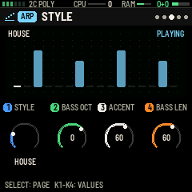 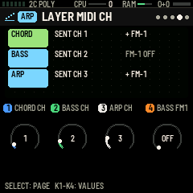

**Page 3, STYLE**:

- **STYLE**: OFF, HELD (the bass holds the chord's root, with no rhythm) or one of 32 rhythms for the bass (below).
- **BASS OCT**: the bass's octave, −2 to +1.
- **ACCENT**: how much louder the accented bass notes (the roots marked as accents) are than the others.
- **BASS LEN**: the bass notes' length, from short and punchy to legato.

**Page 4, LAYER MIDI CH**: **CHORD CH**, **BASS CH** and **ARP CH**, each OFF or 1–16 (1, 2 and 3 to start with), and **BASS FM1**: ON (you hear the bass on the FM-1, and it goes out too) or OFF (it goes out only, to start with). The bass is sent whenever its channel is set.

**Page 5, CHORD + ARP**: the chords' and the arpeggio's FM-1 and SEND switches (above). (If you saved your settings with update 34 or 35, ARP FM-1 may still be OFF: two taps on ARP turn it on.)

How it plays:

- The bass rhythm starts from its first step when you press a chord with nothing held, at the tempo (GLOBAL › TEMPO) or on MIDI clock, and stops when you let go. With ARP › HOLD on, the bass keeps playing the last chord's root until you press another, stop with PLAY, or change a STYLE setting.
- With SEL's CHORD on, the bass follows the latest key you pressed. With CHORD OFF, the keys you hold together make the chord, and the lowest is the bass's root.
- **GLOBAL › MIDI OUT must be on** for the layers to reach other synths. With STYLE OFF, there's no bass; the chords and the arpeggio still go out on their channels when their SEND is on.
- The picture on the STYLE page shows the style's bass rhythm (taller bars are the accented roots), with the step playing lit; the layer pages show where each layer goes. HOME shows the style's name in a tab at the bottom.

| Group | Styles |
| --- | --- |
| Pop, rock, ballad | POP 8THS, POP PUSH, ROCK, POWER ROCK, BALLAD, 6/8 BALLAD |
| Dance | HOUSE, DEEP HOUSE, TECHNO, DISCO, TRANCE, UK GARAGE |
| Drum and bass | DNB ROLLER, LIQUID DNB, JUNGLE |
| Hip-hop and lo-fi | BOOM BAP, TRAP, WEST COAST, LOFI, LOFI JAZZ |
| Groove | FUNK, R&B, NEO SOUL |
| Ambient | AMB SWELL, AMB PULSE, DRONE |
| World and jazz | REGGAE, BOSSA NOVA, SAMBA, AFROBEAT, SALSA, JAZZ SWING |

Most are one bar of 16ths; 6/8 BALLAD is in 12/8 triplets, and AMB SWELL, BOSSA NOVA and SALSA are two bars long. The swung styles (UK GARAGE, BOOM BAP, LOFI, LOFI JAZZ, NEO SOUL and others) swing their 16ths by themselves.

### Shortcuts while you play

These gestures change things without opening a menu:

- **Two quick taps on SEL**: chords off (single notes) or back on; **three taps**: the chords' send off or on.
- **Two quick taps on ARP**: the arpeggio on the FM-1 off or on; **three taps**: its send off or on. (See *Chords and arpeggio: on the FM-1, and sent*, above.)
- **Hold FX, let go, then tap FX**: after the hold the message says **TAP FX 1, TWO TAPS FX 2**. Within 2 seconds:
    - one tap turns FX 1 off or on;
    - two quick taps turn FX 2 off or on;
    - no tap leaves both as they were (**NOTHING CHANGED**).

A switched-off effect shows **OFF** on its HOME tile and costs no processor time. Its settings stay, and when you turn it back on it starts clean, with no old echoes. Loading a preset turns both effects on again; this on/off isn't saved with a preset. UNDO puts back the chord and arpeggio switches, as it does a knob turn.

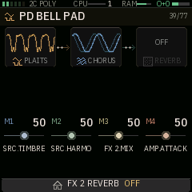

### GLOBAL

GLO opens seven pages:

1. **SETTINGS**: TEMPO (60–180), MIDI CH (OMNI or 1–16), VOICES (AUTO or 1–6), CLOCK (internal or MIDI)
2. **PLAYING**: VEL CURVE, ANIMATION (full, calm, still), LED BRIGHT
3. **TUNING**: TUNING (13: equal, just, Pythagorean, meantone, Werckmeister III, Kirnberger III, rast, bayati, slendro, pelog, 19-, 24- and 31-EDO), T ROOT, A4 HZ, BEND (the pitch-bend range)
4. **MIDI**: PROG CHG, MIDI OUT, OUT CH, LOCAL
5. **MASTER**: LOW, MID and HIGH EQ and COMP, over every preset
6. **SYSTEM**: measured, not set: CPU history, memory, voices, cores
7. **CLICK**: the click track (section 11):
    - **CLICK**: OFF, REC (a click on every beat while recording; to start with) or REC+PLAY (whenever the sequencer runs);
    - **COUNT IN**: OFF, 1 BAR (to start with) or 2 BARS;
    - **CLICK VOL**: its level (MASTER turns it down too);
    - **SOUND**: TICK, BEEP or WOOD. The first beat of each bar is higher.


### MIDI

**In**, over USB or TRS, on GLOBAL › MIDI CH:

- notes, through SEL and the arpeggiator like the keys;
- pitch bend and sustain (CC 64);
- program change, when PROG CHG is on (factory presets, then yours);
- CC 120 and 123 (all notes off);
- CC 20–23 for the macros;
- clock, start and stop, when CLOCK is MIDI: the arpeggiator, the sequencer and the tempo follow it.

**Out**, over USB, when GLOBAL › MIDI OUT is on (off by default):

- the keys' notes and chords on CHORD CH and the arpeggio on ARP CH, when their SEND is on; the STYLE bass on BASS CH; the sequencer on OUT CH (MIDI that came in isn't echoed);
- clock on the internal tempo;
- with +CC, the macros as CC 21–24.

## 11. The sequencer

Tap **SEQ** to open it; it remembers the page you were on. Tap SEQ again, or turn **SELECT**, to step through its six pages: **NOTES, PATTERN, SPICE, GEN, BANKS, SONG**. On each, the four values sit as sliders along the top and the rest of the screen is the piano roll or the page's picture.

- **PLAY** starts and stops it from any page. Stopping also ends held notes (latched chords and the arpeggiator's HOLD).
- It plays at GLOBAL › TEMPO or on MIDI clock, and sends its notes to MIDI out when that's on.
- There are 8 **banks** (A–H) of up to 64 steps. Each step holds up to 6 notes, each with its own length, dynamics (PP, MP, MF, FF, FFF) and articulation (none, staccato, tenuto, accent, marcato), plus a ratchet, nudge, slide, chance and fill condition.

### NOTES: writing steps


- **Step entry**: with the sequencer stopped, play a note or a chord and let go. It's written into the step under the cursor, and the cursor moves on.
- **SELECT** turns the sequencer's pages; **ALGORITHM** moves the cursor four steps.
- **K1** walks through every step, a click each: a step with a note picks it (highlighted), a step with a chord picks each of its notes in turn before moving on, an empty step is passed with nothing picked. **K2** the picked note's pitch, **K3** its length, **K4** its **DYNAMICS**: PP, MP, MF, FF, FFF.
- **Hold SEL and turn K4**: the note's **articulation** instead (the slider reads ARTIC while SEL is held), drawn over the note:
    - none;
    - **staccato** `.`: half as long;
    - **tenuto** `_`: its full length, a little louder;
    - **accent** `>`: a dynamic louder;
    - **marcato** (an accent standing up, like a tepee `^`): two dynamics louder and a little short.

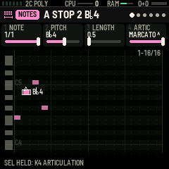

- Only **EDIT** deletes: the note K1 picked (**NOTE DELETED**). Turning K4 down stops at PP.
- **Lasso**: hold **SEL** and turn **K1**: the steps from where you started to where you turn are picked, lit gold. Then:
    - turn **K1** to move the whole group a step a click, **K2** to move all its notes up or down a semitone a click, **K3** to make all of them longer or shorter, **K4** to change all their dynamics, and hold **SEL** and turn **K4** for all their articulations (a message shows the new value);
    - **EDIT** clears every note in them;
    - **hold SAVE** copies them (**COPIED 3 STEPS**; up to 32).
- **Paste**: move the cursor (ALGORITHM, or K1 to a note), then **hold SAVE** with nothing lassoed: what you copied is written from the cursor's step on (**PASTED**). A tap of SAVE still saves the sequencer.
- Note names follow the key signature (SEL's ROOT and SCALE): sharps in G, D, A, E, B and F# major and their relative minors, flats in the others, C included (B♭, E♭...).
- **To finish with a lasso, tap SEL** (**LASSO OFF**): the notes stay where you left them and K1–K4 work on single notes again. Turning ALGORITHM, or SELECT to another page, also ends it.

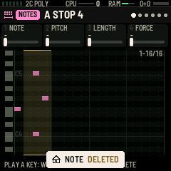

- The roll has a lane for each semitone, a see-through keyboard down its left edge with the C's named, and notes as tall as their lane and at least three quarters of a step wide.

### PATTERN

**K1** LENGTH (1–64 steps), **K2** DIV (1/4, 1/8, 1/16, 1/32, 8T, 16T, 1/2, 1 BAR, 2 BAR, 4 BAR), **K3** SWING, **K4** GATE. ALGORITHM moves the cursor over the step grid.


### SPICE

**K1** SPICE adds random rests, octave jumps and force changes, more as you turn it up. **K2** DICE rolls the same amount differently. **K3** CHANCE sets how often the step under the cursor plays. **K4** FILL: –, FILL (only in a fill) or NO FILL (only outside one).


### GEN: pattern tools

**K1** chooses the tool: EUCLID, RANDOM, ACID, ARP UP, ARP UPDN, BERLIN, OCTAVES, OFFBEAT, ROLLING, STABS, PROGRESS, GATES, SHIFT >, SHIFT <, REVERSE, DOUBLE, HALF or CLEAR. **K2** and **K3** are its two values (for EUCLID, pulses and rotation, with a ring showing the result), and **K4** is the seed. **Turn ALGORITHM right to apply it, left to put the bank back.** New notes follow SEL's scale and key.


### BANKS

**K1** picks a bank. While playing, the switch waits for the end of the loop (the queued bank blinks) unless **K4** SWITCH is NOW. **K2** chooses an action (COPY TO, CLEAR, DOUBLE, HALVE) and **K3** the target bank for COPY TO. **ALGORITHM right** does it, **left** undoes it.


### SONG

16 rows, each a bank with how many times it repeats (1–16) and a transposition (±12). **K1** chooses the row, **K2** the bank (END stops the song there), **K3** REPEATS, **K4** TRANSP. **ALGORITHM right** turns the song on or off; **ALGORITHM left** turns your jam (the banks you've just played, in order) into the song.


### Recording

- **Stopped**: tap REC for **REC READY**. Then **PLAY** counts you in (GLOBAL › CLICK › COUNT IN: a bar of four clicks to start with; the header reads COUNT IN) and recording starts on the next downbeat, with the click going on while you record. Or just play: the first note starts the sequencer recording straight away, with no count-in. PLAY during the count-in stops it; REC cancels REC READY.

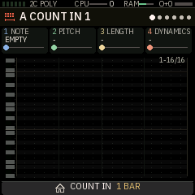

- **Playing**: REC turns recording on and off. What you play is written into the steps as they pass.

### The step layer

**Hold SEQ** (and keep holding) to turn the 16 white keys into steps:

- tap a key to switch that step on (with the notes you last played) or off;
- hold a step's key and turn **K1** NOTE, **K2** DYNAMICS, **K3** RATCHET, **K4** NUDGE;
- **OCT− / OCT+** show the previous or next 16 steps.

Let go of SEQ to play again.


### Keeping the sequencer

The banks, song and MSEQ lanes stay in memory while the FM-1 is on. To keep them after switching off, **press SAVE on a sequencer page**. The sound stops for a moment while the flash is written, which is why FM1 Rack never saves the sequencer by itself while it plays.

## 12. Saving and the library

There are 64 user presets. A user preset keeps the six modules and their parameters, AMP, OSC, the LFOs, all the routes, the macros, the tempo, a name of up to 10 characters and a category.

### Saving

Press **SAVE** for the NAME + SLOT page:

| Control | Does |
| --- | --- |
| SELECT | the letter to change |
| ALGORITHM or K1 | change the letter (A–Z, 0–9, −, #, .) |
| K2 / K3 / K4 | the slot / the category / the page of 16 slots |
| **SAVE** | store it in that slot |
| OCT+ | the library |
| HOME | close |

The preset you saved comes back at power-on.


### The library

From SAVE, press **OCT+**. **K1** (or PRESET) picks a row, **K2** the tab (ALL, USR, BS, PD, LD, CH, FX, OTH), **K3** the action (LOAD, COPY, RENAME, DELETE). **OCT+** does it (DELETE asks twice). OCT− or SAVE goes back to NAME; HOME closes.


## 13. Voices and the processor

The FM-1 has two processor cores. FM1 Rack shares the voices between them: the first core also runs Rings and the reverb, so the second takes more of the voices.

- **Voices**: each preset starts with its own number of voices, up to 6, within what fits in memory and time. SELECT on HOME (or GLOBAL › VOICES) asks for 1–6; FM1 Rack keeps to what fits.
- **SHED n**: if a block of sound takes more than 90 % of its time, FM1 Rack drops a voice and the status strip shows SHED n.
- **TOO HEAVY FOR FM-1**: a preset too heavy even at one voice is muted, with the message at the bottom of HOME and HEAVY in red on the status strip, so the screen and controls keep working. Pick another preset.
- **What costs most**: Plaits voices cost more than Braids voices, and the reverb and Rings are the heaviest modules. The reverb and the delay also use the most memory, so presets with both may get fewer voices. Switching an effect off (section 10) frees its time.

## 14. Factory presets

There are 67: 14 keys (CH), 11 basses (BS), 10 leads (LD), 16 pads (PD), 15 textures (FX) and INIT. PRESET steps through INIT, then the basses, leads, pads, keys and textures, and on to your own; ALGORITHM jumps between categories.

Every preset:

- has four macros that start in the middle (the M1–M4 column below says what each moves);
- responds to velocity in level and tone;
- is matched in loudness to the others, so you can switch without touching MASTER. The struck ones (CH MARIMBA, CH MUSIC BOX, FX CHIMES, FX GLASS RAIN) are a little quieter: their peaks reach the limiter first.

The Voices column gives how many notes each plays at once on the FM-1 (mono, legato and unison presets play one key at a time). Ten presets, marked new, are the FM-1's own; the other 57 are shared with the browser version, though the FM-1 plays some with fewer voices or lighter modules so that every one fits the processor.

### Keys (CH, 14)

| Preset | Built from | Voices | M1 · M2 · M3 · M4 |
| --- | --- | --- | --- |
| CH ROUND EP | Plaits 2OP FM · chorus, plate reverb | 5 | SRC.TIMBRE · SRC.MORPH · FX 1.MIX · FX 2.MIX |
| CH BRIGHT EP | Plaits 2OP FM · chorus, delay | 5 | SRC.TIMBRE · SRC.MORPH · FX 1.MIX · FX 2.MIX |
| CH SOFT PIANO | Plaits MODAL · hall reverb | 5 | SRC.TIMBRE · SRC.HARMO · FX 1.MIX · SRC.MORPH |
| CH MARIMBA | Plaits MODAL · plate reverb | 4 | SRC.TIMBRE · SRC.HARMO · FX 1.MIX · SRC.MORPH |
| CH VIBES | Plaits 2OP FM · chorus, hall reverb | 5 | SRC.TIMBRE · FX 1.DEPTH · FX 2.MIX · AMP.DECAY |
| CH DRAWBAR | Plaits ADDITIVE · chorus | 4 | SRC.TIMBRE · SRC.MORPH · FX 1.RATE · FX 1.DEPTH |
| CH POLY SYNTH | Braids CSAW, filter LP · chorus, plate reverb | 6 | SHP.CUTOFF · SHP.RESO · FX 1.MIX · SHP.F DEC |
| CH NYLON | Plaits STRING · hall reverb | 5 | SRC.TIMBRE · SRC.MORPH · FX 1.MIX · SRC.HARMO |
| CH HARP | Braids PLUK · delay, hall reverb | 6 | SRC.TIMBRE · SRC.COLOR · FX 1.MIX · FX 2.MIX |
| CH CLAV | Plaits WAVESHP, filter LP · chorus | 6 | SHP.CUTOFF · SRC.TIMBRE · FX 1.MIX · SHP.RESO |
| CH MUSIC BOX | Plaits MODAL · delay, hall reverb | 4 | SRC.TIMBRE · SRC.HARMO · FX 1.MIX · FX 2.MIX |
| CH KOTO | Braids PLUK, Rings STRING · plate reverb | 6 | SHP.BRIGHT · SHP.POSITION · FX 1.MIX · SHP.DAMPING |
| CH SYNTH PLUCK (new) | Braids //-_, filter LP · delay, plate reverb | 6 | SHP.CUTOFF · SHP.F DEC · FX 1.MIX · SHP.RESO |
| CH REED KEYS (new) | Plaits WAVESHP · chorus, plate reverb | 6 | SRC.TIMBRE · LFO.RATE 2 · FX 2.MIX · SRC.ENV>TIMB |

### Bass (BS, 11)

| Preset | Built from | Voices | M1 · M2 · M3 · M4 |
| --- | --- | --- | --- |
| BS ROUND SUB | Plaits VA VCF, filter LP24 · OSC sub | legato | SHP.CUTOFF · SHP.RESO · SHP.ENV AMT · AMP.GLIDE |
| BS ANALOG | Braids CSAW, filter LP24 · chorus · OSC sub | legato | SHP.CUTOFF · SHP.RESO · SHP.ENV AMT · SHP.F DEC |
| BS ACID | Braids //-_, filter LP · delay | legato | SHP.CUTOFF · SHP.RESO · SHP.ENV AMT · SHP.F DEC |
| BS PICKED | Plaits 2OP FM, filter LP | mono | SHP.CUTOFF · SRC.TIMBRE · SRC.MORPH · AMP.DECAY |
| BS FINGER | Plaits STRING, filter LP · chorus · OSC sub | mono | SHP.CUTOFF · SRC.TIMBRE · SRC.MORPH · SHP.DRIVE |
| BS PULSE | Plaits VA VCF, filter LP24 · OSC sub | legato | SHP.CUTOFF · SRC.MORPH · SHP.ENV AMT · SHP.RESO |
| BS WARM MOOG | Plaits PAIR VA, filter LP24 | legato | SHP.CUTOFF · SHP.RESO · SHP.DRIVE · AMP.GLIDE |
| BS DUB SINE | Plaits ADDITIVE · delay · OSC sub | legato | SRC.TIMBRE · SRC.HARMO · FX 1.MIX · AMP.GLIDE |
| BS SOFT KEYS | Plaits WAVESHP · chorus | mono | SRC.TIMBRE · SRC.MORPH · FX 1.MIX · SRC.HARMO |
| BS SUB BOOM (new) | Plaits BASS DR | mono | SRC.TIMBRE · SRC.HARMO · SRC.MORPH · AMP.RELEASE |
| BS WOBBLE (new) | Braids //-_, filter LP24, FUNC · OSC sub | legato | SHP.CUTOFF · MOD A.LVL 4 · SHP.RESO · MOD A.FALL 4 |

### Lead (LD, 10)

| Preset | Built from | Voices | M1 · M2 · M3 · M4 |
| --- | --- | --- | --- |
| LD SOFT SAW | Braids CSAW, filter LP · delay, plate reverb | legato | SHP.CUTOFF · SHP.RESO · FX 1.MIX · AMP.GLIDE |
| LD SQUARE | Plaits VA VCF, filter LP · delay | legato | SHP.CUTOFF · SRC.MORPH · FX 1.MIX · AMP.GLIDE |
| LD SYNC | Braids SYN/, filter LP · delay | legato | SRC.TIMBRE · SHP.CUTOFF · FX 1.MIX · SRC.AD>TIMB |
| LD FLUTE | Braids FLUT · hall reverb | legato | SRC.TIMBRE · SRC.COLOR · FX 1.MIX · AMP.ATTACK |
| LD WHISTLE | Plaits 2OP FM · delay, hall reverb | legato | SRC.TIMBRE · AMP.GLIDE · FX 2.MIX · FX 1.MIX |
| LD BRASS | Braids CSAW, filter LP · plate reverb | unison 2 | SHP.CUTOFF · SHP.F ATK · FX 1.MIX · SHP.ENV AMT |
| LD REED | Plaits FORMANT, filter LP · plate reverb | legato | SRC.TIMBRE · SRC.MORPH · FX 1.MIX · SHP.CUTOFF |
| LD BOWED | Braids BOWD, Rings STRING · hall reverb | legato | SHP.BRIGHT · SRC.TIMBRE · FX 1.MIX · SHP.MIX |
| LD UNISON | Braids CSAW, filter LP · delay, plate reverb | unison 4 | SHP.CUTOFF · SHP.RESO · FX 1.MIX · AMP.GLIDE |
| LD PHASE SWEEP (new) | Plaits PHASE D, FUNC · delay, plate reverb | legato | SRC.TIMBRE · MOD A.FALL 1 · FX 1.MIX · AMP.GLIDE |

### Pads (PD, 16)

| Preset | Built from | Voices | M1 · M2 · M3 · M4 |
| --- | --- | --- | --- |
| PD WARM STRINGS | Plaits STR MACH · hall reverb | 5 | SRC.TIMBRE · SRC.MORPH · FX 1.MIX · AMP.ATTACK |
| PD ANALOG | Plaits VA VCF, FUNC · chorus, hall reverb | 4 | SRC.TIMBRE · SRC.HARMO · FX 1.DEPTH · AMP.ATTACK |
| PD CHOIR | Plaits FORMANT · chorus, hall reverb | 4 | SRC.MORPH · SRC.TIMBRE · FX 2.MIX · AMP.ATTACK |
| PD GLASS | Plaits WAVETBL · shimmer reverb | 5 | SRC.TIMBRE · SRC.MORPH · FX 1.MIX · FX 1.SHIMMER |
| PD SOFT SINE | Plaits 2OP FM · chorus, hall reverb | 5 | SRC.TIMBRE · SRC.MORPH · FX 2.MIX · AMP.ATTACK |
| PD RESONANT | Plaits VA VCF, Rings STR+VERB | 4 | SHP.STRUCT · SHP.BRIGHT · SHP.DAMPING · SHP.MIX |
| PD SHIMMER | Plaits 2OP FM · shimmer reverb | 6 | SRC.TIMBRE · FX 1.SHIMMER · FX 1.MIX · AMP.ATTACK |
| PD HAZE | Braids CSAW, filter LP · chorus, hall reverb | 6 | SHP.CUTOFF · SHP.RESO · FX 2.MIX · AMP.ATTACK |
| PD STRING ENS | Braids CSAW, filter LP · chorus, hall reverb | 6 | SHP.CUTOFF · FX 1.DEPTH · FX 2.MIX · AMP.ATTACK |
| PD EVOLVING | Plaits TERRAIN, FUNC · chorus, hall reverb | 5 | SRC.TIMBRE · SRC.MORPH · FX 2.MIX · MOD A.LVL 4 |
| PD DARK | Braids CSAW, filter LP24 · hall reverb | 6 | SHP.CUTOFF · SHP.RESO · FX 1.MIX · AMP.ATTACK |
| PD ORGAN AIR | Plaits ADDITIVE · chorus, delay · OSC sub | 4 | SRC.TIMBRE · SRC.MORPH · FX 2.MIX · AMP.ATTACK |
| PD BELL PAD | Plaits 2OP FM · chorus, hall reverb | 5 | SRC.TIMBRE · SRC.HARMO · FX 2.MIX · AMP.ATTACK |
| PD SAW SWARM (new) | Plaits SWARM · hall reverb | 5 | SRC.TIMBRE · SRC.MORPH · FX 1.MIX · AMP.ATTACK |
| PD TEMPO GATE (new) | Braids CSAW, filter LP, FUNC · chorus, hall reverb | 6 | SHP.CUTOFF · MOD A.FALL 1 · FX 2.MIX · SHP.RESO |
| PD SLOW BLOOM (new) | Braids //x3, filter LP, FUNC · chorus, hall reverb | 5 | SHP.CUTOFF · MOD A.RISE 1 · FX 2.MIX · SHP.RESO |

### Textures (FX, 15)

| Preset | Built from | Voices | M1 · M2 · M3 · M4 |
| --- | --- | --- | --- |
| FX RESONATOR | Plaits 2OP FM, Rings STR+VERB, Tides | 4 | SHP.STRUCT · SHP.BRIGHT · SHP.MIX · SHP.DAMPING |
| FX DRONE | Plaits CHORDS · chorus, hall reverb | 3 | SRC.TIMBRE · SRC.HARMO · FX 2.MIX · SRC.MORPH |
| FX WIND | Plaits NOISE, filter BP · hall reverb | 5 | SHP.CUTOFF · SHP.RESO · FX 1.MIX · AMP.ATTACK |
| FX RAIN | Plaits PARTICLE · delay, hall reverb | 3 | SRC.TIMBRE · SRC.MORPH · FX 2.MIX · FX 1.FEEDBACK |
| FX OCEAN | Braids NOIS, filter LP, Tides · hall reverb | 6 | SHP.CUTOFF · MOD A.FREQ · FX 1.MIX · SHP.RESO |
| FX STRING BLOOM | Plaits VA VCF, Rings STR+VERB | 4 | SHP.BRIGHT · SHP.STRUCT · SHP.DAMPING · AMP.ATTACK |
| FX CHIMES | Plaits MODAL · delay, hall reverb | 4 | SRC.TIMBRE · SRC.HARMO · FX 1.FEEDBACK · FX 2.MIX |
| FX ECHO KEYS | Plaits 2OP FM · delay, hall reverb | 4 | SRC.TIMBRE · FX 1.FEEDBACK · FX 1.MIX · FX 1.WOW |
| FX CHORD DRIFT | Plaits CHORDS · chorus, hall reverb | 3 | SRC.HARMO · SRC.TIMBRE · FX 2.MIX · SRC.MORPH |
| FX TIDAL WASH | Braids CSAW, filter LP, Tides · chorus, hall reverb | 6 | SHP.CUTOFF · SHP.RESO · FX 2.MIX · MOD A.FREQ |
| FX SINGING BOWL | Plaits MODAL · hall reverb | 4 | SRC.HARMO · SRC.TIMBRE · FX 1.MIX · SRC.MORPH |
| FX DEEP DRONE | Braids SUB-, filter LP24 · chorus, hall reverb | 6 | SHP.CUTOFF · SHP.RESO · FX 2.MIX · SRC.TIMBRE |
| FX GLASS RAIN | Plaits WAVETBL, Peaks · delay, shimmer reverb | 4 | SRC.MORPH · SRC.TIMBRE · FX 1.FEEDBACK · FX 2.MIX |
| FX BOUNCE (new) | Plaits WAVESHP, FUNC · delay, hall reverb | 5 | SRC.TIMBRE · MOD A.FALL 1 · FX 2.MIX · MOD A.FALL 4 |
| FX SPEAK (new) | Plaits SPEECH, FUNC · delay | 4 | SRC.TIMBRE · SRC.HARMO · FX 1.MIX · MOD A.RISE 1 |

## 15. Troubleshooting

| What you see | What to do |
| --- | --- |
| No sound, **TOO HEAVY FOR FM-1** | The preset needs more than one core for one voice. Pick another preset, or swap its heaviest module |
| **SHED n** on the status strip | Voices were dropped for time. Play fewer notes, lower the voices, switch an effect off, or choose lighter modules |
| No effect on a preset | It may be switched off: hold FX, let go, then one or two taps; or check the HOME tile for OFF |
| Chords or the arpeggiator won't stop | PLAY ends latched notes; ARP › MODE OFF stops the arpeggiator |
| The keys are silent (except while recording), or HOME shows **KEYS: FM-1 OFF** | The chords' FM-1 stage is off: SEL › CHORD + ARP › CHD FM-1 ON (update 38 turns it back on once). Also check GLOBAL › MIDI › LOCAL is ON |
| The arpeggio is silent, or HOME shows **ARP: FM-1 OFF** | Two quick taps on ARP (or SEL › CHORD + ARP › ARP FM-1) |
| Another synth gets nothing | GLOBAL › MIDI OUT on; three quick taps on SEL or ARP turn SEND on; check CHORD CH / ARP CH |
| A moment of silence when loading a module or editing a delay or reverb | Normal: memory is being laid out again (**MEMORY FITTED**) |
| A short gap when pressing SAVE on a sequencer page | Normal: the flash is being written |
| A page opens a moment after the tap | Normal on buttons with a hold or a double tap: the tap acts once it can't be either |
| The installer can't find the FM-1 | Plug it straight into the Mac (no hub), quit DAWs and Web MIDI tabs, run the script again |
| The FM-1 won't start after an install | Follow section 2, "Getting back to the stock firmware" |
| A preset sounds wrong | Note its name and what you hear, and report it: not every preset has been heard on an FM-1 yet |

## 16. What isn't in yet

- In the sequencer: parameter locks, the free take, capture, note repeat and the FILL trigger (fill conditions are stored, but nothing triggers a fill yet).
- The TOOLS pages (compare, morph, randomize).
- Modules the FM-1 can't hold: Elements, Warps, Clouds and Marbles.
- Bluetooth MIDI, WiFi, screen mirroring, backup and restore, USB MIDI host.

## Credits and licences

FM1 Rack's sound comes from Mutable Instruments' open module code (Émilie Gillet, MIT; Grids GPL-3.0), built for the FM-1 with fm1-base (charlesvestal) on the Felucca platform (GPL-3.0). FUNC is modelled on the behaviour of Make Noise's Maths; it shares no code with it. The rack as a whole is distributed under GPL-3.0, with its source in the MODFM1 repository. This project isn't affiliated with or endorsed by Mutable Instruments, Make Noise or M-VAVE; "Mutable Instruments" is a registered trademark. See the [FM1 Rack Manual](index.html) for the full credits.
