# FM1 Rack on the FM-1: Firmware Manual

Nov 7, 2026 · Josh Cowley

This manual covers **FM1 Rack Lite as firmware on the M-VAVE FM-1**: installing it, the buttons, knobs and screen, editing a sound, the matrix and macros, the keyboard helpers (SEL and ARP), the sequencer, and saving. The browser build has its own manual, the [FM1 Rack Manual](index.html); the two share the same sound engine, modules and factory presets, but the controls on the FM-1 are laid out for the FM-1's panel.

> **Status, 7 November 2026.** The firmware builds and passes every check in the build and in a computer simulator of the FM-1. Menus stages 1–3 (editing, saving, SEL, ARP, GLOBAL) have been played on an FM-1. Stage 4 (the sequencer, the slider screens, LEARN on EDIT) and the new factory presets have only been tested in the simulator so far. Treat this as a test version and keep the recovery steps below to hand.

## Contents

1. Before you install
2. Installing
3. Getting back to the stock firmware
4. The panel
5. The screen
6. HOME
7. Editing a sound
8. Modulation: the matrix, LFOs, macros and LEARN
9. OSC: the second oscillator
10. Playing: SEL, ARP, GLOBAL and MIDI
11. The sequencer
12. Saving and the library
13. Voices, the two cores and overload
14. Factory presets
15. What isn't in yet
16. Troubleshooting

## 1. Before you install

- **Do the recovery round trip once**, so you know you can get back to stock: with the FM-1 plugged **straight into the Mac** (no hub), open Felucca's web installer in Chrome or Edge (hugelton.github.io/Felucca), install Felucca, play it, then choose **Return to official V15**.
- **Run the benchmark first** (`fm1bench.fwsc`) if you haven't: its top line must read **FPU OK: HARDWARE FLOAT, EXACT**. FM1 Rack plays its whole engine in the audio interrupt and relies on that.
- Quit anything else using MIDI (DAWs, browser tabs with Web MIDI) before installing.

## 2. Installing

Everything you need is in the **FM1-Rack** folder (`Documents/iClaude/Projects/FM1-Rack`).

The simple way, in Terminal:

```
sh /Users/josh/Documents/iClaude/Projects/FM1-Rack/install_rack.sh
```

The script checks that `test-kit/packages/fm1rack.fwsc` is exactly the file that was built (its SHA-256 fingerprint), installs the installer's MIDI library if needed, fetches fm1-base's installer at a fixed version, finds the FM-1 and installs. Don't unplug the FM-1 until it says it's done.

By hand, from the `firmware/packages` folder of the repo:

```
shasum -a 256 -c SHA256SUMS
python3 ~/fm1-base/tools/fm1_install.py fm1rack.fwsc
```

The firmware identifies itself as **FM-1_7800**.

## 3. Getting back to the stock firmware

In order of what to try:

1. Felucca's web installer again, then **Return to official V15**.
2. fm1-base's installer page, "Back to the stock firmware".
3. After two failed starts the FM-1 comes up in **safe mode** (no audio, USB on), which accepts an update.
4. After four, the chip's own update mode: M-VAVE's **M-UPGRADE** (Downloads › PC Software) restores stock.

These come from fm1-base and Felucca and haven't been needed with FM1 Rack yet.

## 4. The panel

### Buttons

| Button | Tap | Tap again | Other |
| --- | --- | --- | --- |
| **HOME** | HOME page | the RACK overview; once more, back home with all notes off | Closes the module picker, the SAVE page and LEARN |
| **EDIT** | the source (Plaits or Braids) | OSC, the second oscillator and mixer | **Two quick taps: LEARN on or off** (see 8). A single tap waits 0.3 s before turning the page, so it can tell a double tap |
| **ENV** | AMP (envelopes, voice mode) | the shaper (Rings or the filter) | |
| **LFO** | MOD A | MOD B, the three LFOs (with their target pages), MSEQ, the 12-row MATRIX | |
| **FX** | FX 1 | FX 2 | |
| **ARP** | the arpeggiator | | |
| **SEL** | scale and chord | (SELECT turns to page 2: the keys) | |
| **GLO** | GLOBAL settings | | |
| **SAVE** | the SAVE page | SAVE again stores the preset | On a sequencer page: stores the sequencer |
| **SEQ** | the sequencer, at the page you last used | the next sequencer page | **Hold 0.6 s: the step layer** (see 11) |
| **PLAY** | start / stop the sequencer | | |
| **REC** | stopped: REC READY; playing: recording on / off | | |
| **OCT− / OCT+** | octave down / up | | On SAVE: OCT+ opens the library. In the step layer: the previous / next 16 steps |

Every page button cycles through its pages, and after its last page comes back to the first. A held button only counts as a hold after 0.6 s, so a quick press is never taken for one.

The lit buttons show where you are: the page's button is lit, the others glow (GLOBAL › LED BRIGHT sets how much). SEL glows half while chords or QNT are on, ARP while the arpeggiator is on, PLAY while the sequencer runs, and REC is lit while recording and blinks while REC READY.

### Knobs

| Knob | HOME | A sound page (module, AMP, LFO, OSC) | MATRIX | Sequencer pages |
| --- | --- | --- | --- | --- |
| **PRESET** | presets: factory, then user; the preset loads when you stop turning | the same | the same | the same |
| **ALGORITHM** | category | the module picker | – | the page's action (see 11) |
| **SELECT** | voices, 1–6 | the page within | the row | the step, bank or row |
| **K1–K4** | macros M1–M4 | the page's four parameters | source, destination, amount, via | the page's four values |
| **MASTER** | volume | | | |

**SELECT always goes round**: past the last page (or matrix row) it comes back to the first, in both directions.

### Keys

The 27 keys play notes, with velocity. With the sequencer's step layer open, the 16 white keys are steps instead.

## 5. The screen

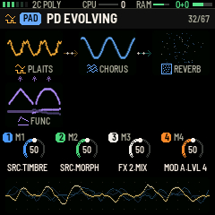

Every page has the same frame:

- **The status strip** (the top line):
  - a light for each voice, lit by its envelope;
  - the cores and voice mode: **2C POLY** (two cores), **1C** (one), **1C\*** (the second core gave up at start);
  - **SHED n** in gold when n voices were dropped for CPU, **HEAVY** in red when a preset is muted (see 13);
  - **CPU** as a small bar and a number (gold above 70 %, red above 85 %);
  - **RAM**: how much of the sound memory the preset uses;
  - the octave (**O+1** and so on; green while keys are held);
  - the output meter (red near clipping).
- **The header**: the page's tag in its colour, the page name, and dots for the pages within it.
- **The well**: a moving picture of what the page does (the module's wave, the filter's curve, the envelope, the LFO shapes, Rings' ripples, the delay's repeats...). GLOBAL › ANIMATION sets it to full, calm or still.
- **The cells**: up to four parameters, each with its number (matching K1–K4), its name, its value and a **slider**.
- **The help line** at the bottom says what the controls do on that page.
- **Messages** appear as a light box near the bottom for a moment ("LOADING", "SAVED TO U01", "PLAITS 6 V").

### Sliders and modulation halos

A parameter that something in the matrix moves **glows in the colour of what moves it**:

- a soft halo round the track shows the range it has swept lately;
- the track fills to where it is now, and the number under it (› 62) is the live value;
- a thin tick stays at the value you set;
- the thumb and the cell's edge glow, brighter the faster the modulation moves.

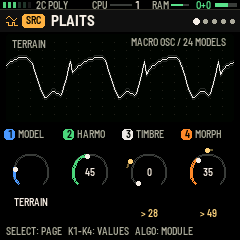

### Colours of modulation

Each kind of modulation source has its own colour everywhere (halos, matrix):

| Source | Colour |
| --- | --- |
| Macros M1–M4 | gold |
| Velocity | green |
| Key tracking | sky blue |
| Random | white |
| AMP ENV and MOD ENV | coral |
| MOD A and MOD B outputs | orange |
| LFO 1–3 | violet |
| SEQ 1–4 (MSEQ lanes) | pink |

## 6. HOME

HOME shows the preset (its category in a coloured tab, its name, and its number, or USER), the output's scope, the chain of six slots as icon tiles, and the four macros.

- **Tiles**: orange source, teal shaper, purple modulators, blue effects. A red tile is a module the preset asks for but that didn't fit in memory.
- **Tabs over the scope** show what's on besides the preset: the scale and chord (SEL), the arpeggiator mode, a tuning.
- **Macros**: each with its value (0–100), a slider and what it moves (the first destination, "+2" if more), or **UNSET**. K1–K4 turn them; MIDI CC 20–23 do too.
- **PRESET** steps through the factory presets, then your user presets; the sound changes when you stop turning. **ALGORITHM** jumps by category. **SELECT** sets the voices (1–6).
- Tap HOME again for **RACK**, an overview of every slot, AMP, the outputs and how many matrix routes are set; tap once more to come home with all notes off.

The sequencer no longer appears on HOME: open it with SEQ.

## 7. Editing a sound

FM1 Rack's voice is a fixed chain of slots:

| Slot | Choices |
| --- | --- |
| **SRC** (source) | Plaits, Braids |
| **SHP** (shaper) | Rings (STRING, FM VOICE or STR+VERB on the FM-1), the filter, or empty |
| **MOD A**, **MOD B** (modulators) | Peaks, Tides, Grids, or empty |
| **FX 1**, **FX 2** | delay, reverb, chorus, or empty (not the same one twice) |
| **AMP** | the envelopes and voice mode (always there) |

### Module pages

Press the slot's button (EDIT for SRC, ENV twice for SHP, LFO for MOD A and B, FX for FX 1 and 2). SELECT turns the pages within the module; K1–K4 set the four parameters shown.

**Changing a module**: on its page, turn **ALGORITHM**. The picker opens on the module now loaded; turn to choose, then press the slot's button again to load it, or HOME to close without changing. Loading stops the sound for a moment while memory is laid out again, then says how many voices fit ("BRAIDS 6 V"), or "NO ROOM" if it doesn't fit.

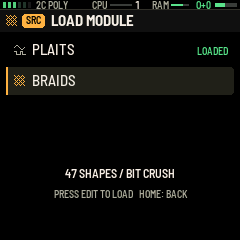

Some edits need more memory (a longer delay, Rings' STR+VERB, the shimmer reverb). When you stop turning, FM1 Rack fits the memory again, with a moment's silence, and says **MEMORY FITTED** and the voices.

Edits aren't kept when you change preset unless you SAVE.

### Rings on the FM-1

On the FM-1 there is **one Rings shared by all the voices**, as on the hardware module: every voice's sound (after AMP's envelope) excites it, and it rings up to **two notes** at once, each new note taking the next resonator, so a third note cuts off the oldest ring. The dry part of each voice (Rings' MIX) plays as before. Rings' parameters follow the last note played. Only the lighter models are offered: **STRING, FM VOICE and STR+VERB**. MODAL, SYMPATH and SYM QNT took more than half of a core for one voice, so a preset asking for them plays STRING. For struck and bell sounds, Plaits' own MODAL and STRING models are the light alternatives.

### AMP

ENV opens AMP: six pages.

1. ATTACK, DECAY, SUSTAIN, RELEASE
2. VEL AMT, GLIDE, SPREAD (stereo), LEVEL
3. M ATTACK, M DECAY, M LOOP (the mod envelope)
4. MODE (POLY, MONO, LEGATO, UNI 2, UNI 4), DETUNE, VINTAGE
5. DELAY, HOLD, A CURVE, D CURVE
6. VEL>ATK, KEY>TIME, M SUST, PITCH ENV

The well shows the envelope on every page. UNI 2 and UNI 4 play two or four detuned voices per key.

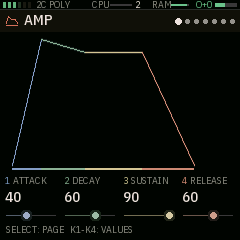

## 8. Modulation: the matrix, LFOs, macros and LEARN

### The LFO button

LFO steps through **MOD A**, **MOD B**, **LFO**, **MSEQ** and the **MATRIX**, then back to MOD A.

### LFOs

The LFO page has nine pages (SELECT):

- pages 1–3: SHAPE (SINE, TRI, SAW, SQUARE, S&H, DRIFT), RATE, SYNC (FREE, 1/16 to 2 BARS), RETRIG for LFO 1, 2 and 3;
- pages 4–6: FADE, PHASE, POLAR, 1SHOT for each;
- pages 7–9: **LFO TARGET**, each LFO's two direct destinations. K1 and K3 choose the destination, K2 and K4 the amount.

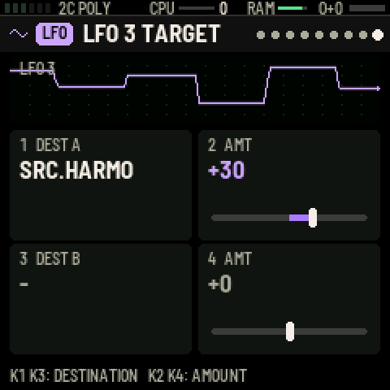

### The matrix

The MATRIX (the LFO button's last page) holds 12 routes. **SELECT** chooses the row; **K1** the source, **K2** the destination, **K3** the amount (−100 to +100), **K4** a "via" source that scales the route (for example velocity, so harder notes modulate more). Each source's name is drawn in its colour.

Sources: M1–M4, VELO, KEY TRK, RANDOM, AMP ENV, A OUT 1, A OUT 2, B OUT 1, B OUT 2 (the modulators' outputs), LFO 1–3, MOD ENV, SEQ 1–4.

Destinations: any parameter that can be modulated on SRC, SHP, MOD A/B, FX 1/2, AMP and OSC.

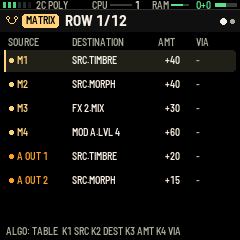

### Macros

M1–M4 are matrix sources you play with K1–K4 on HOME. On the factory presets they start in the middle: the preset sounds as designed with a macro at 50, and turning it moves its parameter either side.

### LEARN: linking a macro by turning a knob

1. On HOME, turn the macro you want (or, once LEARN is on, pick it with SELECT or K1–K4).
2. **Tap EDIT twice quickly.** LEARN is on: the macro is framed in gold on HOME, HOME blinks, and a gold band replaces the help line on every page.
3. Go to a module, AMP, LFO or OSC page and **turn the knob of the parameter** you want the macro to move. The macro is linked to it in the matrix (in the row it already has, or the first free one), and how far you turned sets the amount. A message confirms it, for example **M2>SRC.TIMBRE +24**.
4. Turn more parameters to link more, or **tap HOME (or EDIT twice) to finish**.

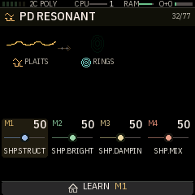

## 9. OSC: the second oscillator

Tap EDIT twice (slowly, more than 0.3 s apart, or it counts as LEARN) to reach OSC: a plain oscillator in every voice, mixed with the source **before** the shaper, so the filter or Rings, AMP and the effects take both.

- Page 1: **WAVE** (SINE, TRI, SAW, SQUARE, PULSE, NOISE), **OCTAVE** (−3 to +2), **SEMI** (±12), **FINE** (±1 semitone).
- Page 2, the mixer: **PW** (pulse width), **OSC LVL** (0 is off, the default), **MAIN LVL** (the source's level, 1 by default).

FINE, PW and both levels are matrix destinations. With OSC LVL at 0 a preset sounds exactly as it did without OSC. Some factory basses use OSC as a sub-oscillator.

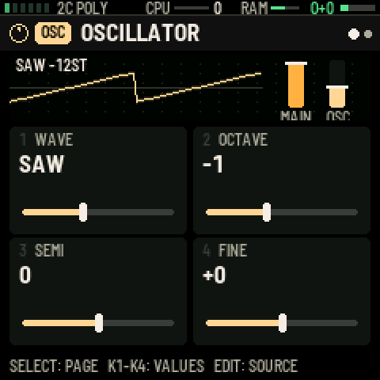

## 10. Playing: SEL, ARP, GLOBAL and MIDI

SEL, ARP and GLOBAL are **settings of the instrument, not of a preset**: they stay when you change preset and are saved by themselves about 3 seconds after your last change.

### SEL: scales, chords and the keys

Page 1, **SCALE + CHORD**: SCALE (9 scales), ROOT, CHORD (OFF, TRIAD, 7TH, 9TH, 11TH, SUS4, 6TH, POWER), VOICING (CLOSE, LEAD, OPEN, INV1, INV2, +OCT). With a chord on, every key plays the scale's chord on that note; the well shows the chord and its name.

Page 2, **KEYS + STRUM**: QNT (snap notes to the scale; WHITE puts the scale on the white keys), HARMONY, ZONE (with chords on, the seven lowest keys, F3–B3, colour the chord: add 6, m7, M7, 9, or force DIM, MIN, MAJ; MIN + MAJ gives sus) and STRUM (up to 80 ms between the chord's notes).

The keys in the scale glow on the keybed.

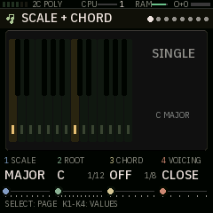

### ARP: the arpeggiator

Page 1: MODE (OFF, UP, DOWN, UPDN, DNUP, RANDOM, ORDER, CHORD, REPEAT, UP+8, CONV, DIVG, PINKY, THUMB, TURING), RATE (1/4 to 1/32 with triplets), OCTAVE (1–4), GATE.
Page 2: HOLD (latch), MUTATE and LOOP (for TURING, a looping random register), SWING.

It follows the tempo (GLOBAL › TEMPO) or MIDI clock. The well shows the pattern and the step playing.

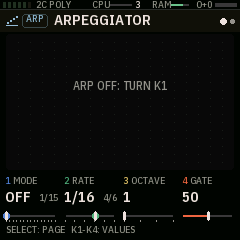

### GLOBAL

GLO opens six pages:

1. **SETTINGS**: TEMPO (60–180), MIDI CH (OMNI or 1–16), VOICES (AUTO or 1–6), CLOCK (internal or MIDI)
2. **PLAYING**: VEL CURVE, ANIMATION (full, calm, still), LED BRIGHT
3. **TUNING**: TUNING (13: equal, just, Pythagorean, meantone, Werckmeister III, Kirnberger III, rast, bayati, slendro, pelog, 19-, 24- and 31-EDO), T ROOT, A4 HZ, BEND (pitch-bend range)
4. **MIDI**: PROG CHG, MIDI OUT, OUT CH, LOCAL
5. **MASTER**: LOW, MID and HIGH EQ and COMP, over every preset
6. **SYSTEM**: measured, not set: CPU history, memory, voices, cores

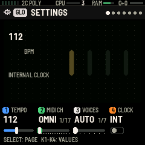

### MIDI

**In** (USB or TRS, on GLOBAL › MIDI CH): notes (through SEL and the arpeggiator, like the keys), pitch bend, sustain (CC 64), program change (factory presets, then user, when PROG CHG is on), CC 120 and 123 (all off), CC 20–23 (macros), and clock with start and stop when CLOCK is MIDI (the arpeggiator, the sequencer and the tempo follow it).

**Out** (USB, GLOBAL › MIDI OUT, off by default): the notes played (chords, arpeggios and the sequencer included; MIDI that came in isn't echoed), clock on the internal tempo, and with +CC the macros as CC 21–24.

## 11. The sequencer

Tap **SEQ** to open it (it remembers the page you were on); tap SEQ again to step through its six pages: **NOTES, PATTERN, SPICE, GEN, BANKS, SONG**. On every sequencer page the four values sit as sliders along the top and the rest of the screen is the piano roll or the page's picture.

- **PLAY** starts and stops it, from any page.
- It plays on the internal tempo (GLOBAL › TEMPO) or MIDI clock, and sends its notes to MIDI out when that's on.
- 8 **banks** (A–H) of up to 64 steps; each step holds up to 6 notes, each with its own length and force (GHOST, SOFT, NORM, HARD, ACC), plus a ratchet, nudge, slide, chance and fill condition.

### NOTES: writing steps

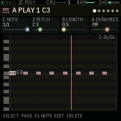

- **Step entry**: with the sequencer stopped, play a note or a chord and let go: it's written into the step under the cursor and the cursor moves on.
- **SELECT** moves the cursor one step; **ALGORITHM** four.
- **K1** chooses a note in the step (and moves on to the next step that has notes). **K2** its pitch, **K3** its length, **K4** its force; turning K4 below GHOST deletes the note.

### PATTERN

**K1** LENGTH (1–64 steps), **K2** DIV (1/4, 1/8, 1/16, 1/32, 8T, 16T, 1/2, 1 BAR, 2 BAR, 4 BAR), **K3** SWING, **K4** GATE. SELECT moves the cursor over the step grid.

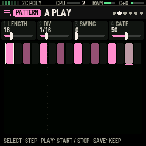

### SPICE

**K1** SPICE (random rests, octave jumps and force changes, more as you turn it up), **K2** DICE (a different roll of the same amount), **K3** CHANCE (the step under the cursor plays this often), **K4** FILL (–, FILL: only in a fill, NO FILL: only outside one).

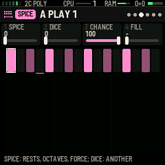

### GEN: pattern tools

**K1** chooses the tool: EUCLID, RANDOM, ACID, ARP UP, ARP UPDN, BERLIN, OCTAVES, OFFBEAT, ROLLING, STABS, PROGRESS, GATES, SHIFT >, SHIFT <, REVERSE, DOUBLE, HALF, CLEAR. **K2** and **K3** are its two values (for EUCLID: pulses and rotation, with a ring showing the result), **K4** the seed. **Turn ALGORITHM right to apply; left to put the bank back as it was.** New notes follow SEL's scale and key.

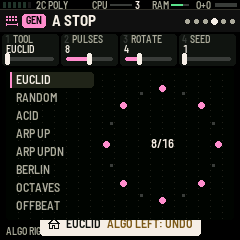

### BANKS

**SELECT** or **K1** picks a bank: while playing, the switch waits for the end of the loop (the queued bank blinks) unless **K4** SWITCH is NOW. **K2** chooses an action (COPY TO, CLEAR, DOUBLE, HALVE), **K3** the target bank for COPY TO; **ALGORITHM right** does it, **left** undoes it.

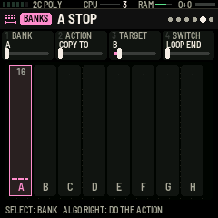

### SONG

16 rows, each a bank, how many times it repeats (1–16) and a transposition (±12). **SELECT** or **K1** the row, **K2** the bank (END stops the song there), **K3** REPEATS, **K4** TRANSP. **ALGORITHM right** turns the song on or off. **ALGORITHM left** turns your jam (the banks you've just played, in order) into the song.

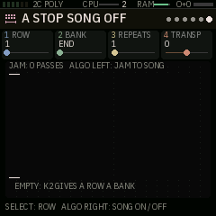

### Recording

- **Stopped**: tap REC for **REC READY**; the first note you play, or PLAY, starts the sequencer recording.
- **Playing**: REC turns recording on and off. What you play is written into the steps as they pass.

### The step layer

**Hold SEQ for 0.6 s** (and keep holding) to turn the 16 white keys into steps:

- tap a key to switch that step on (with the notes you last played) or off;
- hold a step's key and turn **K1** NOTE, **K2** FORCE, **K3** RATCHET, **K4** NUDGE;
- **OCT− / OCT+** show the previous or next 16 steps.

Let go of SEQ to return to playing.

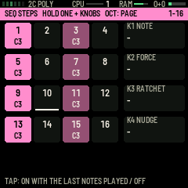

### MSEQ: the modulation sequencer

MSEQ (on the LFO button, after the LFOs) has four lanes of 16 values that step with the tempo. They are the matrix sources **SEQ 1–4**: route one to anything, as you would an LFO.

**SELECT** the step, **ALGORITHM** the lane, **K1** the value (−100 to +100), **K2** a shape to draw across the lane (RAMP+, RAMP−, TRI, SINE, SQR, RND, FLAT, INVERT, SHIFT), **K3** RATE (1/32 to 2 BARS), **K4** SMOOTH.

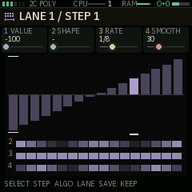

### Keeping the sequencer

The banks, song and MSEQ lanes stay in memory while the FM-1 is on. To keep them after switching off, **press SAVE while on a sequencer page**. The sound stops for a moment while the flash is written, which is why FM1 Rack never saves the sequencer by itself while it plays.

## 12. Saving and the library

64 user presets. A user preset keeps the six modules and their parameters, AMP, OSC, the LFOs, all the routes, the macros, the tempo, a 10-character name and a category.

### Saving

Press **SAVE**: the NAME + SLOT page.

| Control | Does |
| --- | --- |
| SELECT | the letter to change (past the last: the library) |
| ALGORITHM or K1 | change the letter (A–Z, 0–9, −, #, .) |
| K2 / K3 / K4 | the slot / the category / the page of 16 slots |
| **SAVE** | store it in that slot |
| OCT+ | the library |
| HOME | close |

The preset comes back at power-on.

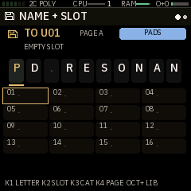

### The library

From the SAVE page, **OCT+**. K1 (or PRESET) picks a row, K2 the tab (ALL, USR, BS, PD, LD, CH, FX, OTH), K3 the action (LOAD, COPY, RENAME, DELETE); **OCT+** does it (DELETE asks twice); OCT− or SAVE goes back to NAME; HOME closes.

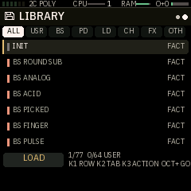

## 13. Voices, the two cores and overload

- The FM-1 has two processor cores; FM1 Rack's second core renders half the voices. The status strip shows **2C**, or **1C\*** if the second core gave up at start.
- Each preset starts with its own number of voices, up to 6 on two cores (4 on one), within what fits in memory. SELECT on HOME (or GLOBAL › VOICES) asks for 1–6; FM1 Rack keeps to what fits.
- If a block of sound takes over 90 % of its time, FM1 Rack drops a voice and the status strip shows **SHED n**.
- A preset too heavy even at one voice is muted with **TOO HEAVY FOR FM-1** on the scope (HEAVY in red on the status strip) so the screen and controls keep working; pick another preset.
- The reverb and the delay use the most memory; presets with them may get fewer voices. Rings is shared by all the voices, so it takes its memory once.

## 14. Factory presets

57 factory presets, the same as the browser build's: 12 keys (CH), 9 basses (BS), 9 leads (LD), 13 pads (PD), 13 textures (FX) and INIT. PRESET steps through them by category (ALGORITHM jumps between categories). Every preset's four macros start in the middle, velocity changes its level and tone, and their levels are matched so you can switch without touching MASTER. The full list, with what each is built from and what its macros do, is in the [FM1 Rack Manual](index.html#factory-presets).

Some basses use OSC as a sub-oscillator on the FM-1 (the browser build has no OSC, so they sound a little thinner there).

## 15. What isn't in yet

- In the sequencer: parameter locks, the free take, capture, note repeat and the FILL trigger (fill conditions on steps are stored, but nothing triggers a fill yet).
- The TOOLS pages (undo, compare, morph, randomize).
- Modules the FM-1 can't hold: Elements, Warps, Clouds and Marbles.
- Bluetooth MIDI, WiFi, screen mirroring, backup and restore, USB MIDI host.

## 16. Troubleshooting

| What you see | What to do |
| --- | --- |
| No sound, **TOO HEAVY FOR FM-1** | The preset needs more CPU than one core has for one voice. Pick another preset, or swap its heaviest module (often Plaits MODAL with a reverb) |
| **SHED n** on the status strip | Voices were dropped for CPU. Play fewer notes, lower VOICES, or choose lighter modules |
| A moment of silence when loading a module or editing a delay or reverb | Normal: memory is being laid out again (**MEMORY FITTED**) |
| A short gap when pressing SAVE on a sequencer page | Normal: the flash is being written |
| EDIT feels slow to turn the page | It waits 0.3 s to see whether a second tap (LEARN) follows |
| The installer can't find the FM-1 | Plug it straight into the Mac (no hub), quit DAWs and Web MIDI tabs, and run the script again |
| The FM-1 won't start after an install | Follow "Getting back to the stock firmware" (section 3) |
| A preset sounds wrong | Note its name and what you hear, and report it: the factory presets haven't all been heard on an FM-1 yet |

## Credits and licences

FM1 Rack's sound comes from Mutable Instruments' open module code (Émilie Gillet, MIT; Grids GPL-3.0), built for the FM-1 with fm1-base (charlesvestal) on the Felucca platform (GPL-3.0). The rack as a whole is distributed under GPL-3.0, with its source in the MODFM1 repository. This project isn't affiliated with or endorsed by Mutable Instruments or M-VAVE; "Mutable Instruments" is a registered trademark. See the [FM1 Rack Manual](index.html) for the full credits.
