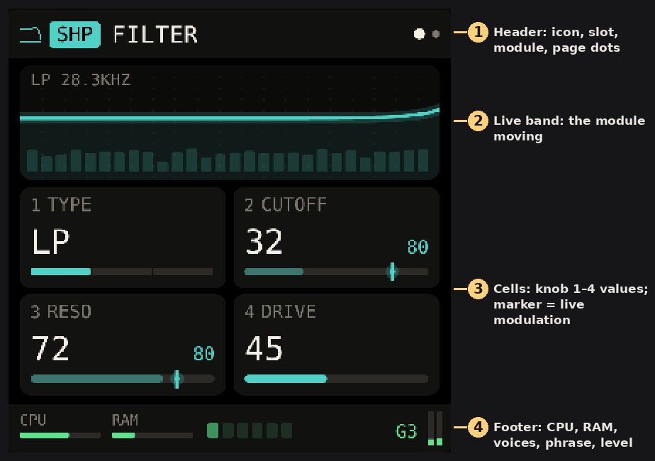
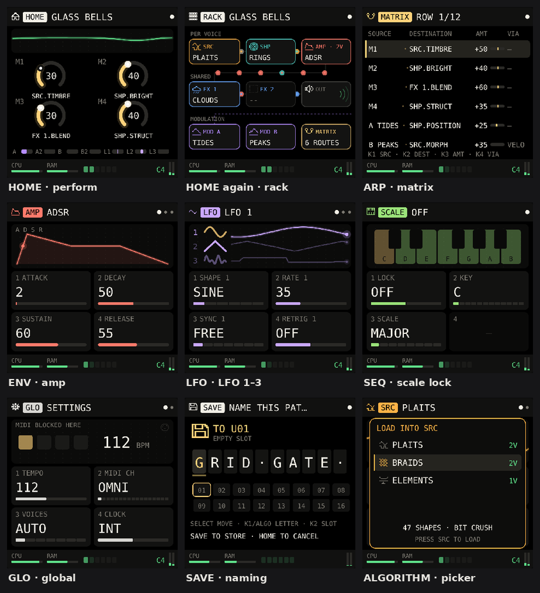
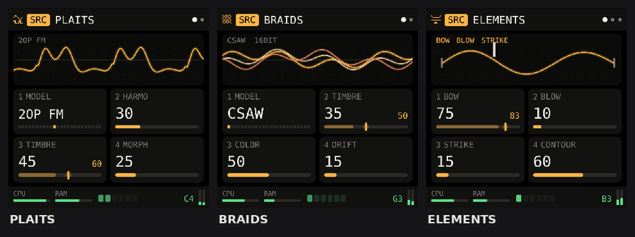
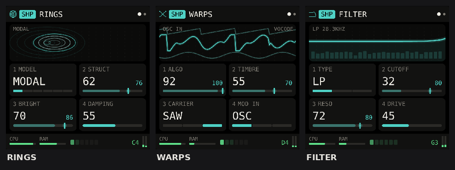
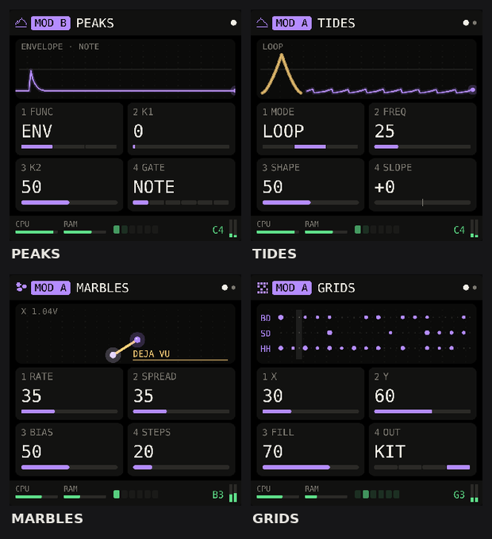
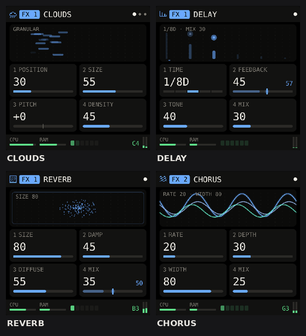

# FM1 Rack 1.4 Manual

Oct 26, 2026 · Josh Cowley

FM1 Rack turns the M-VAVE FM-1 into a small modular synth: you slot Mutable Instruments modules into a fixed voice chain, patch them with a 12-row matrix, and play them through four macros. This manual covers the 1.4 browser build, which runs the original module code.

## Quick start

You can go from switch-on to a saved patch of your own in five steps.

1. **Switch on.** Open the [FM1 Rack browser build](https://claude.ai/artifact/9mWJtyZhwxNKFmqPwhjQ3t) and tap **Switch on** on the screen. The FM1 RACK logo plays, then the HOME page opens on the factory patch GLASS BELLS.
2. **Play.** Tap the keys; tapping lower on a key plays louder. On a computer, the bottom letter row (Z to /) plays the lower keys and Q to O plays the top octave.
3. **Shape the sound.** On HOME, Knobs 1–4 are the four macros. Each macro dial shows where it is routed underneath.
4. **Look inside.** Press **EDIT** to see the source module moving, **ENV** twice for the shaper, **LFO** for modulation, **FX** for effects. Turn **ALGORITHM** to browse other modules for that slot, then press the same button again to load one.
5. **Keep it.** Press **SAVE**, spell a name with **SELECT** and **Knob 1**, choose a user slot with **Knob 2**, and press **SAVE** again.

Turn **PRESETS** at any time to step through the 12 factory patches and your own.

## The panel

FM1 Rack uses the FM-1 exactly as printed: four encoders on the left, the screen, four knobs and twelve buttons on the right, and two rows of keys. Coloured buttons open a slot; the colour matches that slot's pages on screen.

*Diagram: the FM-1 panel map (8 encoders, 14 buttons, 27 keys). It's interactive in the live manual.*

| Control | Turn or tap | Press again, or hold |
| --- | --- | --- |
| MASTER | Output volume | — |
| SELECT | Next or previous page of the current slot; matrix row; step cursor on NOTES; letter position when saving. On HOME it flips to the rack view | — |
| PRESETS | Step through the 12 factory patches, then your user patches | — |
| ALGORITHM | Open the module list for the slot on screen and browse it. On NOTES it moves the cursor four steps; on GEN, right applies the tool and left undoes it | Press that slot's button to load the highlighted module |
| KNOB 1–4 | The four values on screen. On HOME, the four macros | Hold HOME first to assign the knob to a macro (macro learn) |
| OCT − / OCT + | Shift the keys down or up an octave (±3). The button lights when shifted | Hold OCT + on NOTES for the note's sheet. Inside a hold layer they do that layer's job |
| FX | FX 1 | Again for FX 2 |
| SCL | CHORD page: scale chords. SELECT to page 2 for scale lock | Lit green while chords or scale lock are on. Hold for the SCL layer (key, chord, scale) |
| ENV | Amp: ADSR, voice and mod envelope pages (SELECT pages) | Again for the shaper slot (SHP) |
| LFO | MOD A | Again for MOD B, again for LFO 1–3, again for MOD SEQ (the modulation lanes) |
| EDIT | Source slot | On NOTES, deletes the selected note. Hold for the EDIT layer (erase, shift, undo) |
| GLO | Global settings | Hold for the GLO layer (fills, tap tempo) |
| HOME | Perform page (macros and scope) | Again for the rack overview, a third time for TOOLS. Hold for macro learn |
| SAVE | Open the naming screen | Again to store |
| ARP | Mod matrix; press again for the arpeggiator | Hold for the ARP layer (note repeat) |
| SEQ | Sequencer: NOTES, the piano roll | Again for PATTERN, SPICE and GEN in turn. Hold for the SEQ layer (steps, ratchets, locks) |
| PLAY | Start the sequencer | Again to stop it |
| REC | Record into the pattern. Stopped, the first note starts it | Again to stop recording or close a free take. Hold 1.2 s to clear the pattern |
| Keys | Play. Tap lower on a key for more velocity | — |

## The screen

Every slot page has the same four parts, so once you can read one module you can read them all.

1. **Header.** The module's pixel icon, the slot tag in the slot's colour (SRC, SHP, MOD A, MOD B, FX 1, FX 2), the module name, and a dot for each page. The bright dot is the page you're on; turn **SELECT** to move between pages.
2. **Live band.** An animation of what the module is doing right now, driven by the engine: waveforms for sources, ripples for Rings, a frequency curve for the filter, grains for Clouds, rolling marbles, the Grids drum map with its playhead. Each module's band is pictured in the Modules section.
3. **Cells.** One cell per knob. The big number is the value you set. When the matrix or a macro is moving that parameter, a bright marker on the bar shows where it really is, and the small number on the right gives its live value.
4. **Footer.** CPU and RAM use, one light per voice (it glows with that voice's envelope), then the sequencer's 16 steps while it runs or the last note played, and a stereo output meter.

A white message box slides up for a moment after loading a module, changing patch or saving. On HOME the band is an output scope instead, and the cells are the four macro dials.

*This picture shows 1.0. In 1.1, SCL opens CHORD, SEQ opens the sequencer, and the shaper moved under ENV.*

## Signal chain

Each note runs through its own SRC → SHP → AMP chain. The voices are mixed, then pass through FX 1 and FX 2 to the output. Two MOD slots and the built-in sources feed the matrix, which can reach any parameter in the chain.

*Diagram: the FM1 Rack signal chain (6 slots, 1 matrix). It's interactive in the live manual.*

The dashed line is the matrix reaching back into every slot. Every slot except SRC can be empty. The gate bus decides when Peaks, Tides and Marbles fire: on each note, on Grids hits, or on a division of the GLOBAL tempo.

## Pages

There are eleven kinds of page. Every one is reached from a single button, and the button lights while you're on it.

### HOME: perform

The page FM1 Rack opens on. The top strip is a live output scope. Below it are the four macros M1–M4 as dials; under each dial is the first destination it drives, with “+2” if it drives more. The dial glows when it moves. Along the bottom, seven small meters show MOD A, MOD B and LFO 1–3 at work.

Turn **Knob 1–4** to play the macros. The last macro you touched is the one macro learn will assign (see Modulation).

### HOME again: rack

Press **HOME** a second time (or turn **SELECT** on HOME) for the whole rack at a glance: each slot as a tile with its module's icon, dots travelling along the audio path, a pulsing speaker at the output, and the MOD slots and matrix underneath with their route count. The AMP tile shows how many voices the patch has.

### Slot pages

**EDIT** (source), **ENV** pressed twice (shaper), **LFO** (MOD A, MOD B) and **FX** (FX 1, FX 2) open slot pages. Each has the four parts described in The screen. Modules with more than four parameters have more pages; turn **SELECT** to move through them.

**Swapping a module:** on a slot page, turn **ALGORITHM**. A list opens with every module that fits that slot, its icon, and how many voices you'd have with it loaded. Modules that won't fit show why (“✕ CPU” or the RAM they need). Turn to highlight one; the bottom line describes it. Press the slot's own button to load it. Turning any other control closes the list without changing anything, so you can browse safely while playing.

### ENV: amp, then the shaper

Three pages for what every voice shares:

- **ADSR:** attack, decay, sustain, release. The band draws the envelope, and each sounding voice rides it as a dot.
- **VOICE:** VEL AMT (how much velocity changes level), GLIDE (portamento, mono patches only), SPREAD (stereo spread of the voices), LEVEL (patch volume; 50 is unity, 100 is +12 dB). The band shows six voice meters with the notes they're playing.
- **MOD ENV:** M ATTACK, M DECAY, M LOOP. A second, attack–decay envelope per voice for the matrix. With M LOOP on, it cycles while the key is held.

Press **ENV** a second time for the SHP slot (Rings, Warps or Filter, or empty), and again to come back to AMP. Turn **ALGORITHM** there to swap the shaper and press **ENV** to load it.

### LFO: LFO 1–3

Press **LFO** a third time. Three free LFOs for the matrix, one page each (SELECT). The band shows all three: the shape on the left and the live trace on the right, with the selected LFO brighter.

| Parameter | What it does |
| --- | --- |
| SHAPE | SINE, TRI, SAW, SQUARE, S&H (stepped random) or DRIFT (smooth random) |
| RATE | 0.03 to 30 Hz when SYNC is FREE |
| SYNC | FREE, or locked to 1/16, 1/8, 1/4, 1/2, 1 BAR or 2 BARS of the GLOBAL tempo |
| RETRIG | ON restarts the cycle when you play after all keys were up |

### ARP: matrix

Twelve rows, six on screen. **SELECT** picks a row; **Knob 1** source, **Knob 2** destination, **Knob 3** amount (−100 to +100), **Knob 4** via. A small meter on each row shows the route's live output; dots travel along active rows. A destination shown in red belongs to a module that's no longer loaded: the row sleeps until that module comes back.

### SCL: chords

Page 1: CHORD, INVERT, SPREAD, STRUM. Page 2: LOCK, KEY, SCALE (scale lock). The band is a two-octave keyboard: scale notes are tinted, the chord you play lights up note by note, and its name appears beside it with a ring that pulses on each new chord. See **Chords and scale lock** under Playing.

### SEQ: sequencer

The first press shows NOTES, a piano roll of the pattern; further presses give PATTERN, SPICE and GEN. Hold SEQ for the SEQ layer. See **The sequencer** under Playing.

### GLO: global

Settings that belong to the instrument, not the patch; they're remembered between visits. See MIDI and GLOBAL settings for each one. The band shows a four-beat metronome, the tempo, and MIDI status.

### SAVE

See Patches.

## Modules

Fourteen modules fill the six slots. Ten are Mutable Instruments designs running Emilie Gillet's original code; FILTER, DELAY, REVERB and CHORUS are FM1 Rack's own. Values run 0–100 unless a range is given; ± values run −100 to +100.

### Sources (SRC, press EDIT)

#### Plaits

The macro oscillator: 24 models from analog shapes to speech and drums, each played with three macro controls. **Animation:** the waveform, reshaped by HARMO, TIMBRE and MORPH; noise models show a drifting dust field, drum models a burst per note.

| Parameter | What it does |
| --- | --- |
| MODEL | One of 24 models (below) |
| HARMO | Harmonics: the model's main timbral axis, such as detune, chord type or FM ratio |
| TIMBRE | Brightness or the model's second axis |
| MORPH | The model's third axis, such as waveform blend or decay |
| LPG | OFF: the AMP envelope shapes every note. ON: Plaits' low-pass gate plucks each note, shaped by DECAY and COLOUR |
| DECAY | Length of the low-pass gate pluck (LPG ON) |
| COLOUR | From a plain level fade to a closing low-pass filter (LPG ON) |
| LEVEL | Output level of the source |

| Models | Character |
| --- | --- |
| VA VCF, PAIR VA | Analog-style oscillators, filtered or as a pair of classic waveforms |
| PHASE D, WAVESHP, TERRAIN | Phase distortion, waveshaping and wave-terrain oscillators |
| 6OP FM 1–3, 2OP FM | Six-operator FM in three banks of patches, and simple two-operator FM |
| ADDITIVE, WAVETBL, FORMANT | Harmonic, wavetable and granular formant oscillators |
| CHORDS, STR MACH, CHIPTUNE | Chords, string-machine ensemble and chip-style voices |
| SPEECH | Vowels, formants and words |
| SWARM, NOISE, PARTICLE | A swarm of detuned voices, filtered noise and dust |
| STRING, MODAL | Plucked string and struck modal resonator |
| BASS DR, SNARE, HI-HAT | Analog-style drum voices |

#### Braids

The older macro oscillator: 47 shapes from classic saws to physical models, with a bit crusher. Cheap on CPU, so it allows the most voices. **Animation:** three braided strands; lower BITS steps them, lower RATE turns them into stairs.

| Parameter | What it does |
| --- | --- |
| MODEL | 47 shapes: analog (CSAW to //uu), digital filters (ZLPF–ZHPF), formants (VOSM, VOWL, VFOF), additive and FM (HARM, FM, FBFM, WTFM), physical models (PLUK, BOWD, BLOW, FLUT, BELL, DRUM), percussion (KICK, CYMB, SNAR), wavetables (WTBL–WTx4), noise (NOIS–PRTC) and QPSK |
| TIMBRE | The shape's first parameter |
| COLOR | The shape's second parameter |
| DRIFT | Slow random pitch wander, for an analog feel |
| BITS | Bit depth, 2 to 16 |
| RATE | Sample rate, 4 kHz to 48 kHz |
| SIGN | Adds a soft, asymmetric drive |
| LEVEL | Output level of the source |

#### Elements

A full modal voice: a bow, a breath and a mallet exciting a resonating body. Rich and heavy: most patches get one voice. **Animation:** a vibrating string between two bridges; the bow, breath and mallet appear when used.

| Parameter | What it does |
| --- | --- |
| BOW | Bow level |
| BLOW | Breath level |
| STRIKE | Mallet level |
| CONTOUR | Shape of the exciter's envelope, from percussive to swelling |
| GEOMETRY | Shape of the resonator: string, bar, plate, bell |
| BRIGHT | Brightness of the resonator |
| DAMPING | How fast the body stops ringing |
| POSITION | Where on the body it's excited |
| FLOW | Turbulence of the breath |
| MALLET | Mallet character |
| BOW TMB | Roughness of the bow |
| SPACE | Stereo width, rising into reverb |

### Shapers (SHP, press ENV twice)

The source plays into the shaper, one copy per voice. The slot can be left empty.

#### Rings

A resonator the source excites: strings, modal bodies and FM voices that ring on after the note. **Animation:** ripples spread from each note; more STRUCT adds rings, more DAMPING lets them travel further.

| Parameter | What it does |
| --- | --- |
| MODEL | MODAL, SYMPATH (sympathetic strings), STRING, FM VOICE, SYM QNT (quantised sympathetic strings), STR+VERB |
| STRUCT | Structure: the spread of the partials or the chord of the strings |
| BRIGHT | Brightness |
| DAMPING | Higher values ring longer |
| POSITION | Where the body is excited, from muted to hollow |
| EXCITE | How hard the source drives the resonator |
| MIX | Source alone (0) to resonator alone (100) |
| SPREAD | Stereo width, from Rings' odd and even outputs |

#### Warps

A cross-modulator: two signals combined by one sweeping algorithm, up to a vocoder. **Animation:** the carrier above, the modulator below, the result between them.

| Parameter | What it does |
| --- | --- |
| ALGO | Sweeps through Warps' algorithms: crossfade, folding, analog and digital ring modulation, XOR, comparator, and vocoder at the top |
| TIMBRE | The algorithm's parameter |
| CARRIER | SINE, TRI or SAW: the shape of Warps' own oscillator when MOD IN is OSC |
| MOD IN | OSC: Warps' oscillator plays the note and your source modulates it. NOISE: your source is the carrier and noise the modulator. USB IN: audio from a computer over USB, on the FM-1 only; in the browser the source passes through |
| CAR LVL | Level into the carrier input |
| MOD LVL | Level into the modulator input |
| MIX | Source alone (0) to Warps alone (100) |

#### Filter

A resonant state-variable filter with drive, opened by the AMP envelope. **Animation:** the filter's frequency curve with a moving spectrum underneath; the dotted gold line marks the cutoff, live.

| Parameter | What it does |
| --- | --- |
| TYPE | LP, BP or HP |
| CUTOFF | Cutoff frequency |
| RESO | Resonance |
| DRIVE | Saturation before the filter |
| ENV AMT | ± How far the AMP envelope moves the cutoff |
| KEY TRK | How far the cutoff follows the keyboard |

### Modulators (MOD A and MOD B, press LFO)

Modulators make no sound. Their outputs appear in the matrix as sources named after the slot: “A TIDES” is Tides in MOD A, “B PEAKS” is Peaks in MOD B. Their GATE or CLOCK setting picks a trigger from the gate bus: NOTE (any key), GRID (Grids hits), or 1/16, 1/8, 1/4, BAR of the GLOBAL tempo.

#### Peaks

An envelope or LFO. **Animation:** a scrolling trace of its output. Output: **PEAKS**.

| Parameter | What it does |
| --- | --- |
| FUNC | ENV (attack–decay, fired by GATE), LFO, or TAP (an LFO whose speed follows the time between gates) |
| K1 | ENV: attack. LFO: rate. TAP: shape |
| K2 | ENV: decay. LFO and TAP: shape |
| GATE | What fires or syncs it |

#### Tides

A slope generator from Tides 2: one-shot or looping shapes with a curve and a slope. **Animation:** one cycle of the shape on the left, the live output scrolling on the right. Outputs: **TIDES** (swings both ways) and **TIDE+** (positive only).

| Parameter | What it does |
| --- | --- |
| MODE | AD (rise and fall on each gate), LOOP (free-running), AR (rise, hold while the gate is high, fall) |
| FREQ | Speed |
| SHAPE | Curve, from exponential to logarithmic |
| SLOPE | ± Balance between the rise and the fall |
| SMOOTH | ± Below zero smooths the shape; above zero folds it |
| RANGE | LO (slow) or MID (faster) |
| GATE | What fires it in AD and AR |

#### Marbles

Random notes and gates from Marbles' T and X sections, with déjà vu loops. **Animation:** each new note drops a marble at its pitch and rolls it left, so you can watch the melody. Outputs: **MARB X** (a random voltage of 0–2 V; on PITCH at +100 each volt is one octave) and **MARB T** (a pulse on each random gate).

| Parameter | What it does |
| --- | --- |
| RATE | Speed of the random gates when CLOCK is FREE |
| SPREAD | How widely the notes are spread |
| BIAS | Leans the gates and notes one way |
| STEPS | Low values glide; high values snap the notes to C major |
| DEJA VU | 0 is fully random, 50 repeats the loop exactly, above 50 shuffles it |
| LENGTH | Loop length: 1 to 16 steps |
| JITTER | Timing randomness |
| CLOCK | FREE, or 1/16, 1/8, 1/4 of the GLOBAL tempo |

#### Grids

The topographic drum map: a library of rhythms you move through with X and Y. **Animation:** the three lanes (BD, SD, HH) across 32 steps with a moving playhead; dot size is each step's weight and lit dots are the ones that fire at the current FILL. Outputs: **GRID** (a short trigger on each hit) and **ACCENT** (accented hits). Its hits also drive the GRID gate.

| Parameter | What it does |
| --- | --- |
| X, Y | Position on the drum map |
| FILL | Density: how many steps fire |
| OUT | Which lane drives the outputs: BD, SD, HH or KIT (all three) |
| CHAOS | Random variation |

### Effects (FX 1 and FX 2, press FX)

The voices are mixed, then run through FX 1 and then FX 2. Either can be empty. Each effect can be loaded in only one of the two at a time; the module list marks the one already in use.

#### Clouds

The granular texture processor: it records what you play and replays it as clouds of grains, stretched, pitched or frozen. **Animation:** each grain as a short bar, placed by POSITION, lengthened by SIZE and drifting with PITCH; frozen grains turn white and stop.

| Parameter | What it does |
| --- | --- |
| POSITION | Where in the recent past the grains are taken from |
| SIZE | Grain length |
| PITCH | ± Transposition, up to two octaves either way |
| DENSITY | How many grains |
| TEXTURE | Grain envelope, from hard to soft and smeared |
| BLEND | Dry (0) to wet (100) |
| SPREAD | Stereo spread of the grains |
| FEEDBACK | Feeds the output back into the buffer |
| REVERB | Clouds' own reverb |
| MODE | GRANULR, STRETCH (time stretch and pitch shift), LOOPDLY (looping delay), SPECTRL (spectral) |
| FREEZE | ON holds the buffer: play over a frozen texture |

#### Delay

A stereo ping-pong delay locked to the GLOBAL tempo. **Animation:** the echo taps as bars, each lower by FEEDBACK; every note sends echoes bouncing between left and right.

| Parameter | What it does |
| --- | --- |
| TIME | 1/16, 1/8, dotted 1/8, 1/4 or 1/2 of the tempo |
| FEEDBACK | How many repeats |
| TONE | Darker to brighter repeats |
| MIX | Level of the echoes |

Page 2: **MODE** PING (ping-pong, as before), MONO (both sides together) or TAPE (wow and flutter swing the echoes, and the repeats saturate as they pile up), and **WOW**, how much TAPE wobbles.

#### Reverb

The Clouds reverb as its own effect. **Animation:** sound bouncing round a room; the dots dim faster with more DAMP.

| Parameter | What it does |
| --- | --- |
| SIZE | Length of the tail |
| DAMP | Darkens the tail |
| DIFFUSE | From distinct echoes to a smooth wash |
| MIX | Level of the reverb |

Page 2: **TYPE** PLATE (as before), HALL (a longer, darker tail) or SHIMMER (the tail is fed back an octave up, for pitched halos), **PRE** (pre-delay up to 150 ms) and **SHIMMER** (how much of the octave goes back in). In 1.2 the reverb needs 72K of RAM and 8 CPU units.

#### Chorus

A stereo chorus. **Animation:** three waves drifting against each other.

| Parameter | What it does |
| --- | --- |
| RATE | Speed of the sweep |
| DEPTH | How far it sweeps |
| WIDTH | Stereo width |
| MIX | Level of the chorus |

## Modulation

Everything that moves a sound goes through one 12-row matrix on the **ARP** page. Each row reads: *source* × *amount*, scaled by *via*, added to a *destination*. Rows that share a destination add together. The matrix runs about 2,000 times a second.

### Sources

| Source | Range | Notes |
| --- | --- | --- |
| M1–M4 | 0 to 1 | The four macros: Knob 1–4 on HOME, or MIDI CC |
| VELO | 0 to 1 | Per voice: how hard the note was played |
| KEY TRK | −1 to +1 | Per voice: note pitch, centred on C4, two octaves to full scale |
| RANDOM | −1 to +1 | Per voice: a new random value for each note |
| AMP ENV | 0 to 1 | Per voice: the ADSR |
| MOD ENV | 0 to 1 | Per voice: the attack–decay envelope on ENV page 3 |
| LFO 1–3 | −1 to +1 | The three built-in LFOs |
| A … / B … | depends | Outputs of the module in MOD A or MOD B (see Modulators) |

### Destinations

Every parameter that moves continuously can be a destination. They are named by slot and label, such as SRC.TIMBRE, SHP.CUTOFF or FX 1.BLEND, plus AMP.ATTACK to AMP.M DECAY, the LFO rates, **PITCH** (+100 = one octave up) and **PAN**. Switches and model choices (MODEL, LPG, MODE, FREEZE and so on) can't be modulated.

The list follows the rack: load a different module and its parameters appear. A row whose destination belongs to a module you've removed turns red and sleeps; it wakes again if that module returns.

### Amount and via

AMOUNT runs from −100 to +100; at 100 a full-scale source sweeps the whole range of the destination. VIA multiplies the row by a second source: route LFO 1 to PITCH at a small amount with VIA set to M1, and Knob 1 on HOME becomes the vibrato depth. Leave VIA at — for a plain route.

### Macro learn

The fastest way to build a patch. Hold **HOME** for half a second (or Shift-click it): a gold LEARN bar appears, naming the last macro you touched. Go to any slot, ENV or LFO page and turn a knob: instead of changing the parameter, you set how far that macro moves it. A matrix row is created the first time. Turn more knobs to give the same macro more targets. Tap **HOME** to finish. To learn for a different macro, nudge its knob on HOME first.

### Gate bus

Peaks, Tides and Marbles need something to fire them. Their GATE or CLOCK parameter chooses from the gate bus: **NOTE** (high while any key is held), **GRID** (each Grids hit), or **1/16**, **1/8**, **1/4** and **BAR**, which tick at the GLOBAL tempo.

## Deeper editing pages

1.4 adds pages after the existing ones on almost every menu: press the button again, or turn SELECT, to reach them. They are modelled on the hidden settings of the Mutable modules themselves (Braids' setup menu, Plaits' attenuverters and LPG settings, Rings' internal exciter, Clouds' quality button) and on the edit menus of current pro synths (Sequential's Prophet, ASM's Hydrasynth, Korg's minilogue xd, Arturia's MiniFreak).

Every new control starts at a setting that leaves the sound as it was, so your saved patches and the factory patches sound the same as in 1.3. They are ordinary parameters: the matrix, macros, locks, undo, morph and the randomizer all reach them. The randomizer leaves the structural ones alone (octave, tune, quality, sync, VCA and exciter switches, gain).

### ENV (AMP) pages 5 and 6

| Page | Control | What it does |
| --- | --- | --- |
| ENV SHAPE | DELAY | Waits up to 4 s before the attack starts |
|  | HOLD | Holds the peak up to 4 s before the decay |
|  | A CURVE | Attack shape: left is straighter (linear), right is punchier. The attack time stays the same |
|  | D CURVE | Decay and release shape: left is straighter, right drops faster at first (snappier) |
| TRACKING | VEL>ATK | Harder notes get a shorter attack (or longer, turned left) |
|  | KEY>TIME | Higher notes get shorter attack, decay and release, as on an acoustic instrument |
|  | M SUST | Gives the mod envelope a sustain level: it holds there while the key is down, then falls at M DECAY. Ignored when M LOOP is on |
|  | PITCH ENV | The mod envelope bends the pitch, up to two octaves either way: a quick blip for drums and plucks, a slow rise for swells |

The ADSR band now draws DELAY, HOLD and both curves as the engine plays them.

### LFO pages 4 to 6

LFO 1 +, LFO 2 + and LFO 3 + add four controls to each LFO: **FADE** (fades the LFO in after each new phrase, up to about 8 s, for delayed vibrato), **PHASE** (where the cycle starts), **POLAR** (BI swings both ways, UNI only upward, as a tremolo or filter opener should) and **1SHOT** (with a free rate, runs one cycle from each new phrase and stops, an extra envelope).

### Sources

| Module | New page | Controls |
| --- | --- | --- |
| PLAITS | 3 | OCTAVE (±3), FINE (±1 semitone), ENV>TIMB, ENV>MRPH: how far Plaits' own decay envelope moves TIMBRE and MORPH, as its attenuverters do with TRIG patched |
| PLAITS | 4 | ENV>FM (the same envelope on pitch), AUX MIX (fades to Plaits' AUX output: the sub-oscillator in FM, the hard-synced pair in VA, the raw exciter in the physical models) |
| BRAIDS | 3 | OCTAVE, FINE, AD ATK, AD DEC: Braids' internal AD envelope from its setup menu |
| BRAIDS | 4 | AD>TIMB, AD>COLR, AD>PTCH (the envelope's amount on each), AD VCA (ON: the envelope also shapes the level, for plucks and drums) |
| ELEMENTS | 4 | OCTAVE, FINE, BLOW TMB and STRK TMB (the blow and strike exciters' timbre, which were fixed before) |

### Shapers

**FILTER** has three new types on page 1 (LP24, a steeper 24 dB low-pass; NOTCH; PEAK) and three new pages:

| Page | Controls |
| --- | --- |
| 2 | ENV AMT, KEY TRK, **VEL AMT** (velocity opens or closes the cutoff), **ENV SRC** (AMP, the filter's OWN envelope, or the MOD envelope) |
| 3 | F ATK, F DEC, F SUS, F REL: the filter's own ADSR, used when ENV SRC is OWN |
| 4 | **SAT** (the drive stage: SOFT as before, HARD clipping, FOLD wavefolding, ASYM tube-like), **AUDIO FM** (the source moves the cutoff at audio rate, for growl and clang), **GAIN** (±12 dB after the filter) |

**RINGS** page 3: TUNE (±24 semitones), FINE, **INT EXC** (Rings' own pluck, so it rings with or without a source) and **CHORD** (the chord the SYM QNT model's strings are tuned to, 0–10).

**WARPS** page 2: **CAR TUNE** transposes the carrier against the note.

### Modulators

| Module | Added |
| --- | --- |
| PEAKS | Page 2: SUSTAIN (the envelope gets a sustain level) and INVERT |
| TIDES | RANGE gains HI (fast cycles, up to the low audio range); INVERT on page 2 |
| MARBLES | Page 3: SCALE (major, minor, pentatonic, pelog, Raag Bhairav, Raag Shri), T MODEL (the seven rhythm models of the T section), X RANGE (2 V as before, 5 V, ±5 V) and GATE LEN |
| GRIDS | Page 2: DECAY of the trigger envelopes |

### Effects

| Module | Added |
| --- | --- |
| DELAY | TIME gains 1/8T, 1/4T, 1/4D and 1/2D. Page 2: WIDTH (narrower or wider repeats), DUCK (the repeats dip while you play). Page 3: LO CUT (thins the repeats), SYNC (TEMPO, or FREE time), FREE MS (10 ms to 2 s) |
| REVERB | Page 2: LO CUT. Page 3: WIDTH and DUCK |
| CHORUS | Page 2: MODE (CHORUS, FLANGER, VIBRATO), FEEDBACK and DELAY |
| CLOUDS | Page 3: QUALITY (16-bit or 8-bit, stereo or mono, as the hardware's button; 8-bit is lo-fi). Page 4: IN GAIN, NOTE TRG (a grain on each new note) and PITCH TRK (grains follow the note you play) |

The CPU and RAM figures in **Voices and the budget** are unchanged. LP24 and AUDIO FM cost a little more than the other filter types; that will show up when the costs are measured on the FM-1.

## Playing

### Keys, velocity and octave

The FM-1 has 27 keys, F to G across two rows. In the browser, how low you tap a key sets its velocity: near the top is soft, near the bottom is loud. **VEL CURVE** on the GLO page makes the response softer or harder. **OCT −** and **OCT +** shift the keys by up to three octaves either way; the button stays lit while shifted.

How many notes play at once depends on the patch (see Voices and the budget). With one voice, playing legato glides from note to note at the AMP **GLIDE** setting.

### Hold

**KBD HOLD** is the HOLD setting on ARP page 2, with the arp's MODE on OFF. With it ON, notes keep sounding after you let go, and the next key or chord you play replaces them. Turn it OFF to release everything. Held notes keep playing while you change pages and turn knobs, which is the easiest way to sound-design with both hands free. With an arp mode on, the same setting keeps the arp playing the last notes.

### Chords and scale lock

**SCL** opens CHORD. Turn **CHORD** (Knob 1) away from OFF and every key plays a chord built from the KEY and SCALE on page 2. The key you press moves to the nearest scale note and becomes the root, and the other notes are stacked from the scale, so the chords always fit the key: in C major, C plays C, D plays Dm, B plays Bdim.

| Setting | What it does |
| --- | --- |
| CHORD | OFF (single notes), TRIAD, 7TH, SUS2, SUS4, ADD9, 6TH, 9TH, POWER (root, fifth, octave) or QUARTAL (stacked fourths) |
| INVERT | ROOT, 1ST, 2ND or 3RD: lifts the lowest notes up an octave |
| SPREAD | Above 33 the second-highest note drops an octave; above 66 the top note also rises an octave, for wider voicings |
| STRUM | Plays the notes low to high, up to 80 ms apart |
| LOCK (page 2) | Scale lock: with it on, single notes also snap to the nearest scale note (ties go down). Chords follow the scale either way |
| KEY, SCALE (page 2) | C to B; major, minor, dorian, mixolydian, pentatonic major and minor, harmonic minor, whole tone |

Chords work from the keys, MIDI notes, the sequencer's step entry and REC recording. The CHORD and scale settings stay with the instrument, not the patch, and are remembered between visits. The SCL lamp stays green while chords or scale lock are on. A chord needs a voice per note: if the patch has fewer, the CHORD page warns (for example “2 VOICES!”) and newer notes take over older voices.

### The sequencer

Press **SEQ** for the sequencer's four pages in turn: **NOTES**, **PATTERN**, **SPICE** and **GEN**. A pattern has up to 64 steps. Each step holds up to six notes, each with its own length and level, plus a ratchet, a nudge, a chance, a fill condition, a slide and parameter locks. The pattern is part of the patch: SAVE stores it and loading a patch loads it.

**PLAY** starts and stops the sequencer from any page (**Space** on a computer). Its lamp is lit while the pattern runs and flashes on each beat. Starting restarts the gate bus and the modulation lanes, so Grids, the BAR gate and the lanes line up with step 1, and sends MIDI Start. MIDI Start, Continue and Stop from outside run it too.

### Recording with REC

**REC** records into the pattern.

- **Stopped:** press REC and its lamp blinks. The first note you play (or PLAY) starts the sequencer, already recording.
- **Running:** press REC to drop in, and again to drop out. The pattern keeps playing.

Notes land where you play them, with the length you hold them, to a quarter of a step. Recording adds to what is there, so you can build a pattern in passes. On a MONO or LEGATO patch, notes played overlapping are written as slides. Knob turns on slot, AMP, LFO and HOME pages are written as locks on the step that is playing, so you can record a filter sweep step by step.

While REC is waiting, the screen shows two take settings: **MODE** (Knob 1: TEMPO or FREE) and **BARS** (Knob 2: 1, 2 or 4, the length an empty pattern gets).

**Free take.** With MODE on FREE and an empty pattern, press REC and play freely, with no click and no grid. Press REC again to close the loop. The rack reads it as 1, 2 or 4 bars, whichever gives the tempo nearest the one set. If that is within 3% of the current tempo the tempo stays; otherwise the GLOBAL tempo changes to fit your playing, and the notes are placed on 16th steps.

**Clearing.** Hold REC for 1.2 seconds (a ring fills on the screen) to clear every step. The length stays. Undo brings the pattern back.

### The NOTES page

NOTES shows the pattern as a piano roll: pitch up the side, steps across, each note a bar as long as it lasts and as bright as it is loud. The cursor is a column; the selected note is outlined.

| Control | On NOTES |
| --- | --- |
| SELECT | Move the cursor a step |
| ALGORITHM | Move the cursor four steps |
| PRESETS | Zoom: 8, 16, 32 or 64 steps across |
| Knob 1 | Walk from note to note through the pattern; each one plays as you reach it |
| Knob 2 | The selected note's pitch |
| Knob 3 | Its length, in quarter steps, up to 64 steps |
| Knob 4 | Its level: GHOST, SOFT, NORM, HARD or ACC (accent) |
| EDIT | Delete the selected note |

**Step entry.** When not recording, playing on NOTES writes into the cursor step, replacing what was there. Hold several keys before letting go to write a chord, or turn CHORD on and one key writes the whole chord. When you let go, the cursor moves on a step; set **STEP ADV** (GLOBAL page 6) to OFF to keep it in place.

**The sheet.** Hold **OCT +** for half a second on NOTES to open the selected note's sheet. Knob 1 picks a row and Knob 2 changes it: **SLIDE** (glide into the next step on a mono patch), **NUDGE** (early or late, up to half a step), **FILL** (see below) and **MOVE** (shift the note a step at a time). On **COPY** (puts a copy straight after the note) and **DELETE**, press OCT + to do it. OCT − closes the sheet.

### PATTERN, SPICE and GEN

| Page | Knob 1 | Knob 2 | Knob 3 | Knob 4 |
| --- | --- | --- | --- | --- |
| PATTERN | LENGTH, 1–64 steps | DIV: 1/4, 1/8, 1/16, 1/32, 8T, 16T, 1/2, 1 BAR or 2 BAR per step | SWING: delays every second step (no effect on 8T or 16T) | GATE: the length new notes get |
| SPICE | SPICE: how much the pattern varies | DICE: another variation | CHANCE: how often the cursor step plays | FILL: the cursor step's fill condition |
| GEN | TOOL | A | B | SEED |

**SPICE** adds rests, octave jumps and small changes of level and length to random steps; the more SPICE, the more steps change. The variation is fixed by **DICE**, so the same DICE number always gives the same pattern: turn it until you like one and leave it there. The PATTERN page's overview marks spiced steps.

**Fills.** A step's FILL condition is — (plays always), **FILL** (plays only during a fill) or **NO FILL** (rests during a fill). Fills are played from the GLO layer (below).

**GEN** builds or reworks the pattern in the CHORD KEY and SCALE. Pick a **TOOL**, set **A**, **B** and **SEED**, and turn **ALGORITHM** right to apply it; turn it left to undo. A and B are named on screen for each tool.

| Tool | A / B | What it does |
| --- | --- | --- |
| EUCLID | PULSES / ROTATE | Spreads the pulses as evenly as possible across the length |
| RANDOM | DENSITY / LEAPS | Random scale notes; LEAPS widens the jumps |
| ACID | DENSITY / SLIDES | A 303-style line with accents and slides |
| ARP UP, ARP UPDN | OCTAVES / GATE | Arpeggiates the scale chord |
| BERLIN | VARIANT / GATE | A sequencer-school bass ostinato |
| OCTAVES | DENSITY / GATE | Root and octave jumps |
| OFFBEAT | VARIANT / GATE | Notes off the beat |
| ROLLING | DENSITY / GATE | A rolling 16th bass line |
| STABS | DENSITY / 7THS | Chord stabs |
| PROGRESS | VARIANT / 7THS | A chord progression, one chord per bar |
| GATES | DENSITY / VARIANT | Rhythm only: keeps the notes, changes which steps play |
| SHIFT >, SHIFT < | — | Moves the pattern a step later or earlier |
| REVERSE | — | Plays the pattern backwards |
| DOUBLE, HALF | — | Doubles the pattern (up to 64 steps) or halves the length |
| HUMANIZE | VELO / NUDGE | Small random changes of level and timing |
| CLEAR | — | Empties the pattern |

### Hold layers

Hold **SEQ**, **EDIT**, **ARP**, **GLO** or **SCL** for a moment and its layer appears: a grid of tiles and dials over the page, and the keys, knobs and OCT buttons take on that layer's job while you hold it. Let go to leave. To keep a layer open, Shift-click its button, or tap **HOME** while holding it; the button blinks, and pressing any other button except PLAY and REC closes it. On every layer, **SELECT** changes the tempo.

| Layer | Keys | Knobs | OCT − / OCT + |
| --- | --- | --- | --- |
| SEQ | The 16 white keys are 16 steps. Tap one to add a step (with the layer's NOTE) or clear it. The first four black keys pick steps 1–16, 17–32, 33–48 or 49–64 | No step held: NOTE, DIV, SWING, LENGTH. Steps held: pitch, level, ratchet (1–4 hits) and nudge; PRESETS sets a lock on them and ALGORITHM picks the locked parameter (the last knob you turned to begin with) | Page through the steps. With steps held, OCT + cycles their fill condition and OCT − clears their nudge, locks and fill |
| EDIT | Hold a key to erase that pitch: stopped, from the whole pattern; running, from each step it passes while you hold it | Knob 1 shifts the pattern a step; Knob 2 doubles or halves the length; Knob 3 transposes it | Undo and redo |
| ARP | Hold a key for note repeat, on the grid; while recording, the repeats are written as ratchets | Knob 1: repeat rate (1/8, 1/16, 1/32, 32T, 1/64) | — |
| GLO | Hold the 9th white key for a fill; tap the 10th for a fill on the next bar; tap the last (16th) for tap tempo | Knob 1: patch level | — |
| SCL | A key sets the KEY | CHORD, SCALE, scale LOCK, INVERT | — |

A step held on the SEQ layer and then released without turning anything toggles; once you turn a knob, the step is kept. Locks show with a gold L on the knob they sit on, and a step with locks but no notes changes the sound without playing a note.

## Tools

Press **HOME** three times (HOME, the rack, then TOOLS). Turn **SELECT** for the four pages.

**UNDO.** Every change to the patch becomes a step once you stop turning: knobs, modules, the matrix, the sequencer and the mod lanes. Turn **Knob 1** left to go back through up to 16 steps and right to go forward; the band lists them. Turn **Knob 2** to ORIG to hear the patch as it was loaded, and back to EDIT for your changes. HOME shows a gold **EDITED** tag while your patch differs from what was loaded.

**MORPH.** Turn **Knob 1** right to store the current patch as A, change it, then turn **Knob 2** right to store B. **Knob 3** moves every parameter between them; switches and module choices change half way. **Knob 4** (VIA) hands the morph to a macro, so M1–M4 on HOME or a MIDI CC can sweep it. The band shows how far apart A and B are, parameter by parameter.

**RANDOM.** **WHAT** picks the section (SRC, SHP, AMP, MOD, FX, MATRIX or ALL) and **AMOUNT** how far it moves. Turn **Knob 3** right to roll; turn **Knob 4** left to go back. Levels and FREEZE are left alone.

**LIBRARY.** **FILTER** limits what PRESETS steps through: ALL, FAVS, USER, or the patches built on PLAITS, BRAIDS or ELEMENTS. **FAVOURITE** pins the current patch: favourites come first in every list and show a star. Both are remembered in this browser.

## Arpeggiator

Press **ARP** twice (the matrix, then the arp). With MODE away from OFF, the keys and MIDI notes stop sounding directly and feed the arp instead; chords from SCL feed it too.

| Page 1 |  |
| --- | --- |
| MODE | OFF, UP, DOWN, UPDN, DNUP, RANDOM, ORDER (as played), CHORD (all together), REPEAT, UP+8, CONV (outside in), DIVG (inside out), PINKY (each note then the top), THUMB (the bottom then each note), TURING |
| RATE | 1/4, 1/8, 1/8T, 1/16, 1/16T, 1/32 of the tempo |
| OCTAVE | 1–4 octaves |
| GATE | Note length |

| Page 2 |  |
| --- | --- |
| HOLD | With an arp mode: the arp keeps playing the last notes after you let go; the next chord replaces them. With MODE on OFF this is KBD HOLD for the keys |
| MUTATE | TURING: how often a bit of the loop flips (0 locked, 100 wild) |
| LOOP | TURING: the loop's length, 1–16 steps |
| SWING | Delays every second note |

**TURING** is a looping shift register in the spirit of Music Thing's Turing Machine: it picks notes from what you hold, repeats its loop, and changes it as often as MUTATE says. The band lights its bits. The ARP lamp stays lit while the arp is on. Arp settings belong to the instrument, not the patch.

## Modulation sequencer

Press **LFO** four times for MOD SEQ: four lanes of 16 steps that run with the tempo, read by the matrix as **SEQ 1** to **SEQ 4**. **SELECT** moves the step cursor and **ALGORITHM** picks the lane.

| Knob | What it does |
| --- | --- |
| VALUE | The cursor step's value, −100 to +100 |
| SHAPE | Turn through RAMP+, RAMP−, TRI, SINE, SQR, RND, FLAT, INVERT and SHIFT to rewrite the lane; you hear each as you pass it |
| RATE | 1/32 to 2 bars per step, for all lanes |
| SMOOTH | Glides between steps in this lane |

The lane being edited is drawn big with the playing step lit; the other three run underneath. The lanes are saved with the patch and restart with the sequencer, so they stay in time with it.

## Patches

A patch is the whole rack: which module is in each slot, every parameter, the ENV and LFO pages, all 12 matrix rows, the four macro positions and the sequencer pattern with its locks. GLOBAL and CHORD settings stay with the instrument, not the patch.

### Factory patches

Twelve patches, each built to show off a pairing. Their levels were balanced by rendering them through the engine, so you can switch between them without reaching for MASTER.

| Patch | Chain | Macros M1 · M2 · M3 · M4 | Play it |
| --- | --- | --- | --- |
| GLASS BELLS | Plaits 2-op FM → Rings modal → Clouds. Tides drifts the strike point; Peaks adds a velocity-scaled morph | Timbre · Rings brightness · Clouds blend · Rings structure | Chords |
| ACID DRIFT | Braids saw → resonant low-pass → Delay → Chorus. Grids accents drive the filter; Tides fires on Grids hits | Cutoff · Resonance · Delay feedback · Timbre | Low notes |
| BOWED SPACE | Elements bowed → Reverb. Marbles wanders the bow position | Bow · Brightness · Reverb mix · Geometry | Long single notes |
| STRING MACH | Plaits string machine → Chorus → Reverb. LFO 1 and LFO 2 move timbre and morph | Timbre · Morph · Chorus depth · Reverb mix | Slow chords |
| SPEECH DUST | Plaits speech → Clouds. Marbles picks the words | Harmonics · Clouds density · Clouds blend · Marbles rate | Hold one note (KBD HOLD helps) |
| KARPLUS | Braids pluck → Rings string → Delay. Velocity brightens | Damping · Brightness · Delay feedback · Position | Picked notes, soft and hard |
| FOLDED BASS | Braids wavefolder → low-pass. The mod envelope sweeps the fold | Timbre · Color · Cutoff · Drive | Low notes; set GLO VOICES to 1 for glide |
| WARPED VOX | Plaits formant → Warps vocoder → Reverb. Tides moves the vowel | Warps algorithm · Warps timbre · Harmonics · Reverb mix | Chords |
| GRID GATE | Braids wavetable → low-pass → Delay → Reverb. Grids chops the level | Grids X · Grids Y · Grids fill · Timbre | Hold a chord (KBD HOLD helps) |
| FROZEN CLOUD | Plaits chords → Clouds stretch. LFO 2 drifts the position over two bars | Clouds size · Texture · Blend · Timbre | Chords, then FREEZE on FX 1 page 3 |
| TIDAL FM | Plaits 6-op FM → low-pass → Chorus → Delay. Tides sweeps the cutoff per note; Peaks pans | Harmonics · Morph · Cutoff · Delay feedback | Chords |
| INIT | Plaits virtual analog, nothing else | Timbre · Morph | A blank start |

ACID DRIFT (a 16th-note acid line with cutoff and resonance locks) and STRING MACH (four slow chords) also come with a sequencer pattern: load one and press **PLAY**.

### Saving your own

1. Press **SAVE**. The naming screen shows the patch's current name, a row of letter tiles and the 16 user slots.
2. Turn **SELECT** to move between letters, and **Knob 1** or **ALGORITHM** to change the letter under the cursor (space, A–Z, 0–9, −, #, .).
3. Turn **Knob 2** to pick a user slot. It starts on the first empty one; a filled slot shows “REPLACES” and the name you'd overwrite.
4. Press **SAVE** again to store, or **HOME** to cancel.

User patches appear after the factory ones as U01 to U16 when you turn PRESETS. Factory patches are never overwritten: saving always writes to a user slot. In the browser, user patches and GLOBAL settings are kept by this browser on this device, the way the FM-1 keeps them in its flash. A private window forgets them when it closes.

## Voices and the budget

The FM-1's chip can only do so much arithmetic per second, so the rack keeps a running budget and tells you what each choice costs before you make it.

### How the sums work

The budget is **80 CPU units** and a **256K RAM pool**. Every module has an estimated CPU cost and RAM need. The CPU figures are estimates; they'll stay estimates until each module is measured on the FM-1's chip.

- **Per-voice modules** (SRC, SHP and the AMP's 1 unit) run once for every voice, so their cost is multiplied.
- **Shared modules** (MOD A, MOD B, FX 1, FX 2) run once, whatever the voice count.
- **Voices** = (80 − shared cost) ÷ per-voice cost, rounded down, capped at 6 (or at the GLOBAL **VOICES** setting).

| Module | CPU | RAM |  | Module | CPU | RAM |
| --- | --- | --- | --- | --- | --- | --- |
| Plaits | 9 per voice | 8K |  | Peaks | 1 | 1K |
| Braids | 4 per voice | 2K |  | Tides | 1 | 1K |
| Elements | 40 per voice | 64K |  | Marbles | 3 | 4K |
| Rings | 14 per voice | 40K |  | Grids | 1 | 2K |
| Warps | 10 per voice | 8K |  | Clouds | 22 | 118K |
| Filter | 2 per voice | 1K |  | Delay | 3 | 64K |
| AMP | 1 per voice | — |  | Reverb | 6 | 32K |
|  |  |  |  | Chorus | 2 | 4K |

**Worked example, GLASS BELLS.** Plaits 9 + Rings 14 + AMP 1 = 24 per voice. Tides 1 + Peaks 1 + Clouds 22 = 24 shared. (80 − 24) ÷ 24 = 2.3, so 2 voices, using 72 of 80 units and 168K of RAM.

### What the factory patches get

| Voices | Patches |
| --- | --- |
| 6 | ACID DRIFT, STRING MACH, FOLDED BASS, GRID GATE, TIDAL FM, INIT |
| 5 | SPEECH DUST, FROZEN CLOUD |
| 4 | KARPLUS |
| 3 | WARPED VOX |
| 2 | GLASS BELLS |
| 1 | BOWED SPACE (Elements is the heaviest module by far) |

### Where you see it

- **Footer, on every page:** a CPU bar and a RAM bar (they turn red above 72 units or 85% of the pool), six voice lamps (one for each voice you have, glowing with that voice's envelope) and the stereo output meter.
- **RACK page:** the AMP tile shows the voice count, for example “AMP · 2V”.
- **Module picker:** every candidate shows the voices you'd have after loading it, or ✕ with the reason it won't fit (“✕ CPU”, “✕ 118K RAM”). Modules that don't fit can't be loaded. Make room by emptying a slot or choosing a lighter module elsewhere.
- **AMP page 2 (VOICE):** a larger view of the voices and the note each one is playing.

### When you play more notes than there are voices

A new note takes a free voice first. If none are free it takes the voice that was released longest ago, and if every voice is still held it takes the oldest held note.

With one voice (Elements patches, or VOICES set to 1) the rack plays **mono legato**: a note played while another is held changes pitch without restarting the envelopes, and **GLIDE** on AMP page 2 slides between them. Glide only works in mono.

### Voice modes and VINTAGE

AMP page 4 (**MODE**):

| MODE |  |
| --- | --- |
| POLY | As above |
| MONO | One voice; every note restarts the envelopes |
| LEGATO | One voice; overlapping notes glide without restarting (GLIDE works here and in MONO) |
| UNI 2, UNI 4 | Each note plays 2 or 4 voices spread by **DETUNE** (up to 30 cents). A UNI 4 note uses four of your voices |

**VINTAGE** makes the voices behave like an analog poly's: each voice gets its own small fixed tuning error (up to 6 cents), a slow drift (up to 5 cents), and each note a little of its own. At 0 it does nothing.

## GLOBAL settings and MIDI

Press **GLO** for the instrument-wide settings. They aren't part of any patch, and they're remembered between visits. The visual on page 1 flashes the beat (gold on the downbeat), shows the tempo and reports MIDI: how many inputs are connected, “NO MIDI INPUT”, or “MIDI BLOCKED HERE” if the browser refused access. The MIDI icon lights green while messages arrive.

### Page 1

| Setting | Range | What it does |
| --- | --- | --- |
| TEMPO | 60–180 BPM, default 112 | Drives the gate bus (GRID, 1/16, 1/8, 1/4, BAR), synced LFOs, Delay time, the Marbles clock, the arp and the sequencer |
| MIDI CH | OMNI, 1–16 | Which channel the rack listens to. OMNI takes every channel |
| VOICES | AUTO, 1–6 | AUTO gives as many voices as the budget allows, up to 6. A number caps it lower; 1 gives mono legato with glide |
| CLOCK | INT, MIDI | INT uses TEMPO. MIDI follows incoming MIDI clock |

### Page 2

| Setting | Range | What it does |
| --- | --- | --- |
| VEL CURVE | 0–100, default 50 | 50 is linear. Higher values make soft playing louder (a light touch); lower values need a firmer hit to get loud |
| ANIMATION | FULL, CALM, STILL | FULL redraws at about 30 frames a second. CALM slows the motion to under half speed at 20 frames. STILL freezes the moving graphics and updates values only. If your system asks for reduced motion, the rack starts on CALM |
| LED BRIGHT | 0–100 | Brightness of the button lamps |

### Page 3: TUNING

| Setting | What it does |
| --- | --- |
| TUNING | EQUAL, JUST (5-limit), PYTHAG, MEANTONE (quarter-comma), WERCK III, KIRNB III, RAST and BAYATI (maqam neutral intervals), SLENDRO, PELOG, 19-EDO, 24-EDO, 31-EDO |
| T ROOT | The tonic the tuning is built on |
| A4 HZ | The reference pitch, 400–480 Hz (432, 415, 442…), under every tuning |
| BEND | The pitch bend range, 0–24 semitones |

Twelve-note tunings keep the keyboard as it is and retune each note. SLENDRO (5 notes), PELOG (7) and the EDOs map consecutive keys to consecutive steps, so a 19-EDO octave spans 19 keys. The band shows each degree against equal temperament.

### Page 4: MIDI

PROG CHG (program changes load patches), MIDI OUT (OFF, NOTES, or +CC), OUT CH (1–16) and LOCAL (ON, or OFF so the keys only send MIDI). See **MIDI over USB** below.

### Page 5: MASTER

LOW EQ (a shelf at 150 Hz), MID EQ (a peak at 1 kHz) and HIGH EQ (a shelf at 5 kHz), each ±12 dB (MID ±10), and **COMP**, one knob for a bus compressor that lowers the threshold from −6 to −30 dB and raises the ratio from 2:1 to 4:1, with make-up gain. After it, a limiter looks 1 ms ahead so loud attacks are already turned down when they arrive. The band draws the EQ curve and two meters for the compressor's and limiter's gain reduction. EQ and COMP are part of the instrument, not the patch.

### Page 6: SYSTEM

A live readout of the audio engine: **CPU** (the share of real time spent rendering), **PEAK** (the slowest recent block) and **LATE** (blocks that took longer than real time, each a possible click), with a graph, beside the FM-1 budget estimate in units. These are browser measurements; on the FM-1 the same readout will tell us the real costs.

**STEP ADV** (ON or OFF): whether the NOTES cursor moves on a step after you enter a note.

### MIDI over USB

Plug in any class-compliant USB MIDI keyboard or controller. In the browser the rack asks for MIDI access when you switch it on; on the FM-1 it would arrive over the USB port.

In 1.2 the rack speaks MIDI both ways over the same USB connection. Set the channel it listens on with **MIDI CH** (page 1) and what it sends on the **MIDI** page below.

**MIDI in**

| Message | Effect |
| --- | --- |
| Note on / off | Plays notes, with velocity through VEL CURVE, CHORD and scale lock; feeds the arpeggiator when it is on, and the sequencer's step entry on NOTES or REC recording |
| Pitch bend | Bends every voice by up to the GLOBAL **BEND** range (0–24 semitones) |
| Channel pressure, poly aftertouch, CC 2 (breath) | The **PRESS** matrix source |
| CC 1 (mod wheel) | Macro M1, and the **WHEEL** matrix source |
| CC 7 | MASTER volume |
| CC 11 | Expression: scales the output level |
| CC 16–19 and CC 21–24 | Macros M1–M4 |
| CC 70–73 | Knobs 1–4 of the page on screen, so one controller can edit any page |
| CC 64 | Sustain |
| CC 120 / 123 | All sound off / all notes off |
| CC 121 | Reset controllers: bend, expression, wheel, pressure, sustain |
| CC 122 | Local control on or off |
| Program change, with bank select (CC 0) | Loads patch bank × 128 + program from the full list (when PROG CHG is on) |
| Clock | With CLOCK = MIDI, the tempo follows, averaged over two beats |
| Start / Continue / Stop | Start restarts the gate bus and the sequencer from step 1; Continue starts a stopped sequence; Stop stops it |

**MIDI out** (GLOBAL page 4, MIDI OUT set to NOTES or +CC)

| What | Sent |
| --- | --- |
| Notes | From the keys (chords and strums included), the sequencer (ratchets included) and the arpeggiator, on **OUT CH**, timed against the audio clock |
| Clock | 24 per beat while CLOCK = INT, with Start and Stop when the sequencer starts and stops |
| +CC | Macro moves as CC 21–24, the four knobs on screen as CC 70–73, and a program change when you turn PRESETS |

With **LOCAL** OFF the keys only send MIDI and don't play the rack, for a DAW that sends the track back. Notes that arrive over MIDI are never sent back out. On the FM-1 hardware the same messages would travel over its USB-C port through the Felucca USB-MIDI layer; that part isn't ported yet.

## Computer keyboard and mouse

These apply to the browser build. On the FM-1 itself you'd use its keys and knobs.

### Notes

The three letter rows cover all 27 keys of the FM-1's keybed, F3 to G5, laid out like a piano. Computer keys play at a fixed medium velocity; tap the on-screen keys lower down to play louder.

| Row | Keys | Notes |
| --- | --- | --- |
| Bottom (white keys) | Z X C V B N M , . / | F3 G3 A3 B3 C4 D4 E4 F4 G4 A4 |
| Middle (black keys) | S D F · H J · L ; ' | F♯3 G♯3 A♯3 · C♯4 D♯4 · F♯4 G♯4 A♯4 |
| Top (carries on upward) | Q W E R T Y U I O | B4 C5 C♯5 D5 D♯5 E5 F5 F♯5 G5 |
| Number row | − = | Octave down, octave up (±3) |

The gaps in the middle row (G and K) sit where a piano has no black key.

**Space** starts and stops the sequencer from any page, like PLAY.

### Knobs

- **Drag** up or down on a knob to turn it.
- **Scroll** over a knob with a mouse wheel or trackpad.
- **Tab** to a knob, then use the **arrow keys**: up or right turns clockwise, down or left anticlockwise. While a knob has keyboard focus the letter keys don't play notes; click anywhere outside the knobs to play again.

SELECT, PRESETS, ALGORITHM and Knobs 1–4 are endless encoders, as on the FM-1, so their pointer just spins. MASTER is a normal knob with a fixed range.

### Buttons

- **Click** a button to press it.
- **Hold HOME** for half a second, or **Shift-click HOME**, to start macro learn. Click HOME again to leave it.
- Ctrl, Alt and Cmd combinations are left alone, so browser shortcuts keep working.

**Hold** SEQ, EDIT, ARP, GLO or SCL with the mouse for its hold layer, or **Shift-click** it to keep the layer open. Hold REC for 1.2 seconds to clear the pattern.

## Troubleshooting

| What's happening | What to try |
| --- | --- |
| No sound after **Switch on** | Turn **MASTER** up (a toast shows the volume). Check the tab isn't muted and the computer's output. Watch the output meter at the bottom right of the screen: if it moves, the rack is playing and the problem is further down the line |
| The switch says “Couldn't start” | The browser couldn't load the audio engine. Reload the page and try again; use a current Chrome, Edge, Firefox or Safari |
| A patch is much quieter than the others | Check **LEVEL** on SRC page 2 and AMP page 2, and **VEL AMT** if you're playing softly. Factory patches are balanced so this usually means a level was turned down |
| Distortion | The output meter turns red near full scale. Lower **MASTER** or the patch LEVEL, or reduce feedback on Delay, Clouds or Rings |
| A module won't load | The picker says why: “✕ CPU” (not enough processing for even one voice), “✕ 64K RAM” (not enough memory left) or “✕ IN FX 1” (that effect is already in the other FX slot; each effect can only be loaded once). Empty a slot or swap in something lighter |
| Chords lose notes | The patch has fewer voices than notes. See the voice lamps in the footer and **Voices and the budget**; lighter modules give more voices |
| Notes keep sounding | **KBD HOLD** may be on (ARP page 2, HOLD): turn it OFF. The sequencer may be running (the PLAY lamp flashes): press PLAY. From MIDI, lift the sustain pedal or send CC 123 |
| Keys play the wrong notes | **SCL** chords or scale lock may be on (the SCL lamp stays lit green), or the octave is shifted (an OCT lamp is lit). A running pattern also plays notes: press PLAY or Space to stop it |
| Computer keys don't play | A knob has keyboard focus. Click anywhere outside the knobs. Keys held with Ctrl, Alt or Cmd are ignored |
| “NO MIDI INPUT” | Connect the controller before switching on, or replug it; the count updates when devices appear |
| “MIDI BLOCKED HERE” | The browser, or the page the rack is shown in, refused MIDI access. Not every browser offers Web MIDI; a Chromium-based browser is the safest bet. The on-screen and computer keys still work |
| MIDI clock is ignored | Set GLOBAL **CLOCK** to MIDI. “BPM EXT” appears once a beat of clock has arrived. Tempos outside 60–180 BPM are clamped |
| Marbles shows X 0 at first | Normal. It needs a few clock ticks before its first random value |
| Grids or BAR gates seem out of time with a sequencer | Send MIDI Start; it restarts the gate bus at beat 1 |
| User patches have gone | They live in this browser's site storage. A private window, cleared site data or a different browser or device won't have them. If a save shows “SAVED FOR THIS VISIT ONLY”, the browser blocked storage |
| The graphics feel busy or the laptop runs warm | Set GLOBAL **ANIMATION** to CALM or STILL. The sound is unaffected |
| A button blinks and the keys do something else | A hold layer is kept open. Press any button except PLAY or REC to leave it |
| The pattern has gone | Holding REC for 1.2 seconds clears it. Undo from the EDIT layer (OCT −) or on the TOOLS UNDO page |

## Hardware status, credits and licences

### Where 1.0 stands

This is the **browser build**. The sound engine is real: the same C++ module code that would run on the FM-1, compiled to WebAssembly and run in an AudioWorklet at 48 kHz in blocks of 24 samples. The screen, keys and knobs are a faithful stand-in for the FM-1's 240×240 display and controls, so the interface you learn here is the one the firmware would have.

It has **not yet been built for or run on the FM-1**. What's still to do:

- **Port the engine** onto the Felucca platform layer (audio driver, display, keybed, knobs, flash storage) as in the FM1 Modular plan.
- **Measure real costs.** The CPU units in **Voices and the budget** are estimates. They need re-measuring on the AC791N, which the FM1 Modular notes record running at 240 MHz with 578 KB of SRAM and a 1 MB flash image. Clouds and Elements are the modules most likely to need trimming.
- **Fit the flash image.** Plaits' wavetables and Braids' tables are the large items to check against the 1 MB image.
- **Move user patches** from browser storage to the FM-1's flash.

### Credits

- **Plaits, Braids, Elements, Rings, Warps, Clouds, Peaks, Tides 2, Marbles and Grids** are Émilie Gillet's original Mutable Instruments code from the open-source eurorack repository, with stmlib. The REVERB slot uses the reverb from Clouds and the FILTER uses stmlib's state-variable filter.
- **DELAY and CHORUS**, the gate bus, mod matrix, macros, voice allocation and the whole interface were written for this rack.
- **Felucca** is the open firmware platform the FM-1 port builds on, via FM1 Modular.
- The screen font is **DotGothic16** by Fontworks.
- Built with clang/LLVM, wasi-libc and libc++.

Many 1.2 and 1.3 workflows follow ideas from **Clipper** (isod89's FM-1 firmware, after SLOOP and Felucca): undo and compare, morph, randomize by section, favourites, ratchets and nudge, spice and dice (after the Arturia MicroFreak), pattern generators, the sequencer's PLAY and REC workflow, piano roll, hold layers, free takes and fills, the Turing arp (after Music Thing Modular's Turing Machine), modulation lanes, VINTAGE, the tunings, the delay and reverb modes, the master section and the CPU readout. They were rebuilt here from Clipper's descriptions; no Clipper code is used.

### Licences

| Part | Licence |
| --- | --- |
| Mutable Instruments STM32 module code and stmlib | MIT |
| Grids (an AVR project in the same repository) | GPL-3.0 |
| Felucca platform | GPL-3.0 |
| DotGothic16 | SIL Open Font License |
| LLVM libc++ | Apache 2.0 with LLVM exception |

Because Grids and Felucca are GPL-3.0, the rack as a whole is distributed under GPL-3.0, with its source. The source pack (engine, interface and build scripts) accompanies this manual.

### Names and trademarks

This project isn't affiliated with or endorsed by Mutable Instruments or M-VAVE. **“Mutable Instruments” is a registered trademark**, and the repository's guidelines for derivative works ask that the name not be used on derivative works and recommend against keeping the original module names. The module names are used in 1.0 so you can tell where each sound comes from. **Before any public release, the modules should be renamed on screen** (for example MACRO OSC for Plaits, RESONATOR for Rings) and the credit kept here, in the manual.
